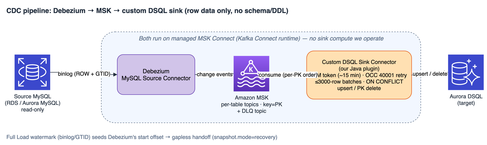

# 4. CDC 동작 방식과 DSQL 제약 처리

_언어: [English](../en/04-cdc-and-dsql-constraints.md) | **한국어** | [日本語](../ja/04-cdc-and-dsql-constraints.md)_

> **이전:** [3. Full Load](03-full-load.md)
>
> **CDC에서 컬럼을 빼려면** [13.8 CDC 캡처 목록](13-excluding-tables-and-columns.md#138-cdc-캡처-목록)을 보세요.

**CDC**(Change Data Capture)는 거의 무중단 전환을 위한 **선택적** 스트리밍 파이프라인입니다. Full
Load가 기존 행을 복사한 뒤, CDC는 소스의 모든 신규 insert/update/delete를 반영해 DSQL을 계속 최신
상태로 유지합니다. 덕분에 긴 중단 대신 최소 다운타임으로 전환할 수 있습니다.

CDC가 필요한 경우는 **대규모 또는 지속적** 마이그레이션뿐입니다. 짧은 동결이 허용되는 일회성
전환이라면 Full Load만으로 충분합니다.

---

## 4.1 파이프라인

  

- **Debezium 소스 커넥터(MySQL 또는 PostgreSQL)**가 소스 변경 로그 — MySQL은 바이너리 로그,
  PostgreSQL은 논리 복제 슬롯을 통한 WAL(write-ahead log) — 를 읽어 변경 이벤트를 냅니다. 소스는 읽기
  전용으로 유지되며, 허용된 예외는 두 가지입니다: PostgreSQL 소스에서는 도구가 마이그레이션 대상
  테이블에만 한정된 논리 슬롯과 publication을 생성(하고 해체 시 삭제)하고, `gtid_mode=ON`이 아닌
  MySQL 소스에서는 Full load + CDC 실행이 시작 지점을 기록한 직후 `FLUSH BINARY LOGS`를 한 번
  실행합니다([§3.5](03-full-load.md#35-워터마크--cdc로의-다리)).
- **Amazon MSK**(Kafka)가 내구성 있는 백본 역할을 합니다. **테이블당 토픽 1개**, 기본 키로 키잉(한
  행의 모든 변경이 한 파티션에 순서대로 유지), 그리고 DLQ 토픽, Debezium **스키마 히스토리** 토픽
  (새 시작 지점에서 `recovery`가 만들고 재시작 때 재생되는 대상 — **MySQL 소스 전용**이며,
  PostgreSQL/pgoutput 커넥터에는 스키마 히스토리 토픽이 없음), 그리고 유휴 구간에도 커밋된 소스 위치를
  전진시켜 재시작 지점이 유휴 구간 때문에 뒤처지지 않게 하는
  **하트비트** 토픽 — MySQL은 binlog offset, PostgreSQL은 슬롯의 확정 LSN(이는 WAL 누적도 막아 줌) — 으로
  구성됩니다(재시작에 빈틈이 없는 것은 싱크가 적용하지 않은 변경을 CDC 토픽이 아직 보존하는 동안뿐: §4.3).
- **커스텀 DSQL 싱크 커넥터**(이 프로젝트가 소유한 Java Kafka Connect 플러그인)가 변경을 DSQL에
  적용합니다. 두 커넥터 모두 **관리형 MSK Connect**에서 실행되며, 도구는 **자체 싱크 컴퓨트를 돌리지
  않고** 컨트롤 플레인 역할만 합니다(구성 작성, 재개 지점 확립 — MySQL은 Kafka 시작 오프셋을 시드하고,
  PostgreSQL은 논리 복제 슬롯과 publication을 생성 — 모니터링). CDC 스택은 배포될 때의 플러그인을 그대로
  씁니다. Start CDC는 새 플러그인을 등록하지 않으므로, 스택이 이 버전의 도구에 들어 있는 것보다 오래된 싱크
  플러그인을 실행하는 동안 CDC 단계가 그렇게 알려 주며(*This CDC infrastructure runs an older sink
  plugin*), **Delete CDC infrastructure** 후 다시 배포하면 들어 있는 플러그인이 등록됩니다.

**왜 표준 JDBC 싱크가 아니라 *커스텀* 싱크일까요?**

표준 JDBC 싱크는 DSQL의 단기 IAM 토큰으로 인증할 수 없고, 낙관적 동시성 충돌(`SQLSTATE 40001`)이나
DSQL이 거부하는 행을 DSQL에 맞게 처리하지도 않습니다. 커스텀 싱크는 충돌한 **트랜잭션**(≤3000행 청크
하나, 또는 행 하나)을 지수 백오프와 full jitter로 직접 다시 실행하고, 거부된 행은 DLQ로 보내면서 그
청크의 나머지는 그대로 반영하며, DSQL의 단기 IAM 토큰과 재연결을 처리합니다(자세한 내용은 §4.4).

---

## 4.2 CDC는 스키마가 아니라 데이터를 복제 — 중요

CDC는 **행 수준 데이터 변경**(insert/update/delete)을 복제합니다. SQL 문이나 **DDL**은 복제하지
**않습니다.** 구체적으로:

- 싱크는 행 변경(DML)만 적용함. MySQL 소스에서는 커넥터가 `include.schema.changes=false`로도 실행되므로
  스키마 변경 이벤트가 Kafka에 도달하지 않음. PostgreSQL 소스에서는 `pgoutput` 스트림에 DDL이 아예 없으며,
  Debezium은 테이블의 다음 변경 앞에 오는 스트림의 Relation 메시지에서 그 테이블의 새 형태를 알게 됨.
- 소스 **DDL**(`ALTER TABLE`, `CREATE`, `DROP` 등)은 DSQL로 **전파되지 않음.**

DSQL 타깃 스키마는 **Schema Conversion** 단계에서 고정됩니다. **CDC 중 소스 스키마를 바꾸면**,
Aurora DSQL에 대응하는 변경을 직접 하되, CDC가 스트리밍하는 동안에는 Schema Conversion으로 하지 마세요:
그동안에는 그 Apply가 **Replace**를 포함해 차단됩니다. Replace는 테이블을 삭제하고 다시 만들므로, 이미 로드된
행은 사라지고 이후 변경은 **Drop & reload**로 다시 로드할 때까지 빈 테이블에 쓰입니다. 무엇을 실행할지는
변경에 따라 다릅니다(아래 표 참고):

- 추가되거나 이름이 바뀐 컬럼: 드리프트 배너의 **Fix target schema…**를 쓰거나, 같은 `ALTER`를 Aurora DSQL에서
  직접 실행;
- 이제 NULL을 허용하는 소스 컬럼, 또는 삭제할 소스 컬럼이 Aurora DSQL에서 `NOT NULL`인 경우: Aurora DSQL에서
  `ALTER TABLE … ALTER COLUMN … DROP NOT NULL` 실행(소스에서 삭제하기 전에);
- 타입·키 변경: CDC를 중지한 상태에서 테이블을 다시 만듦: Schema Conversion의 **Replace**, 그다음
  **Drop & reload**. 아래 표의 설명대로 함(CDC only라면 그 CDC only 복구 방법을 따름).

소스보다 먼저 Aurora DSQL에 해도 안전한 것은 추가 변경뿐입니다: 싱크는 컬럼 이름을 지정하므로, NULL을 허용하는
여분의 타깃 컬럼은 무시합니다. 타깃이 일치할 때까지, 타깃 형태로 쓸 수 없는
행(예: 새 컬럼 참조)은 **DLQ**로 dead-letter 처리되며 재시도되지 않고, 그런 테이블이 마지막 dead-letter
레코드 이후 CHECKSUM을 통과할 때까지 Cut over는 잠긴 상태로 남습니다
([§5.5](05-validation.md#55-cdc-dead-letter와-컷오버)). 하지만 어떤 변경은 dead letter 없이 **조용히**
적용됩니다 — 아래 [데드레터를 남기지 않는 변경](#데드레터를-남기지-않는-변경-소스-스키마-재확인)을
참고하세요.

### CDC 중 소스 스키마 드리프트 감지·처리

소스 `ALTER`를 직접 눈치챌 필요가 없습니다. 데드레터 레코드가 소스 형태 변경을 시사하면, 도구가
SQLSTATE와 레코드 형태로 드리프트를 **분류**(아래 표)하고 CDC 단계에 **"소스 스키마 변경
감지"** 배너를 표시합니다. 추가되거나 이름이 바뀐 컬럼에 대해서는 **"Fix target schema…"**를 제공합니다: 양쪽에서
테이블의 현재 정의를 읽고, 정확한 문을 보여 주며, 승인했을 때만 적용합니다(트랜잭션당 1 DDL). 그러면 그
테이블의 CDC가 재개됩니다.

- **새 컬럼**은 추가됩니다(`ALTER TABLE … ADD COLUMN`, NULL 허용, 기본값 없음).
- **이름이 바뀐 컬럼**은 이름 변경으로 보일 때 이름을 바꾸고(`ALTER TABLE … RENAME COLUMN`) 값을
  유지합니다: Step 1 인벤토리의 같은 위치에 같은 타입으로 이전 이름이 있거나, 소스 스키마 재확인이 이름 변경을
  보았거나, 두 이름이 대소문자만 다른 경우입니다. 카탈로그로는 이름 변경과, 같은 위치에서 컬럼 하나를 삭제하고
  같은 타입의 컬럼을 추가한 경우를 구별할 수 없습니다(추가된 컬럼은 테이블 끝에 붙음). 소스가 그렇게 했다면
  취소하고 컬럼을 직접 추가하세요: 대화 상자가 그 문을 보여 줍니다. 그렇지 않으면 추가된 컬럼으로 제안되며,
  소스에 없는 Aurora DSQL 컬럼을 짚는 경고가 함께 표시됩니다. 그것이 이전 이름이라면 취소하고 직접 이름을
  바꾸세요.
- **기본 키나 CDC 키 컬럼의 이름이 바뀌었거나, 삭제되었거나, 키가 바뀐 테이블은 아무것도 바꾸지 않습니다.**
  CDC는 그 키로 행을 쓰고 삭제하므로 컬럼을 추가해도 고쳐지지 않습니다: 쓰기는 계속 실패하고 삭제는 아무 행에도
  맞지 않은 채 조용히 지나갑니다. Aurora DSQL은 기본 키를 그 자리에서 바꾸거나 기본 키 컬럼을 삭제할 수 없으므로,
  대화 상자는 대신 다시 만드는 단계를 안내합니다: Stop CDC, Step 1 재실행, Schema Conversion에서 테이블을
  **Replace**로 다시 적용, **Drop & reload**로 리로드, Start CDC(CDC only: 소스에서 키를 되돌리거나 **Start
  over** 사용). CDC가 재키잉하는 테이블(Composite key)은 **Delete CDC infrastructure**와 새 배포도 필요합니다.
- **제외 설정이 막는 컬럼은 추가하지 않습니다**: 저장된 제외 규칙에 맞는 새 컬럼, 소스에서 이름이 바뀐 제외
  컬럼, 또는 제외 컬럼이 소스에서 사라진 동안의 모든 새 컬럼입니다. CDC는 여전히 그 컬럼을 보내고, 대화 상자가
  그 테이블의 다른 컬럼을 추가하거나 이름을 바꾸더라도 캡처 목록이 바뀔 때까지 그 행은 계속 데드레터로 갑니다.
  [§13.8](13-excluding-tables-and-columns.md#138-cdc-캡처-목록)을 참고하세요.
- **생성** 컬럼이나 Aurora DSQL이 담을 수 없는 타입의 컬럼은 추가하지 않으며, 대화 상자가 직접 추가하는 방법을
  알려 줍니다.
- **ENUM** 컬럼은 `CHECK` 없이 `text`로 추가됩니다(Aurora DSQL의 `ADD COLUMN`은 제약을 받지 않음). 경고에 그
  `CHECK`를 추가하는 `ADD CONSTRAINT … CHECK (…) NOT VALID` 문이 나옵니다.

아래 표의 모든 거부와, 더 이상 존재하지 않는 타깃 테이블(`42P01`), 고유 키 충돌(`23505`; 그 행은 고유 인덱스 이름과
생길 수 있는 원인 — 기본 키 변경이나 행 사이를 옮겨 가는 고유 값(§4.4), 복합 키 테이블의 선행 컬럼
업데이트(§4.6), 그리고 소스가 그 `UNIQUE` 인덱스를 삭제하거나 완화한 경우(CDC는 이를 복제하지 않으므로
Aurora DSQL에서도 삭제) — 을 알려 줌), 싱크가 바인딩할 수 없는 값(`07006`)은 같은 방식으로 배너 행이 생기며, 직접 해결하도록 표시만 합니다(도구는 타깃 데이터를 자동으로
삭제하거나 다시 쓰지 않습니다). 소스 `TRUNCATE`는 별도의 배너가 생깁니다(아래 참고). 그 밖의 데드레터는 자체
배너 행이 생기지 않고 데드레터 큐 카드에만 나타납니다:

- 그 밖의 SQLSTATE로 인한 거부(예: `22P02`, `22007`/`22008`, `22021`, `23503`, `54000`). 그 SQLSTATE와 함께
  표시됨;
- Aurora DSQL에 비해 너무 큰 값([§4.5](#45-1-mib-값당-한도-그리고-dlq));
- 싱크가 변환할 수 없는 값. 예: PostgreSQL의 `timetz[]`, `bytea[]` 또는 제약 없는 `numeric[]` 컬럼(Evaluation이 이런 컬럼을 미리 알려 줍니다, `CDC_UNCARRYABLE_COLUMN`. 대신 NULL로 도착하는 컬럼도 함께: `interval[]`, `money[]`, `tsvector`, `tsquery`, 기하 타입 `box`, `circle`, `line`, `lseg`, `path`, `polygon`, 그리고 대부분의 확장 타입, 예: pgvector의 `vector`([§6.2](06-limitations.md#62-마이그레이션-프로세스-한계))). 스칼라 `point`는 싱크 플러그인 v54부터 자신의 텍스트 `(x,y)`로 기록됩니다;
- 소스 기본 키가 삭제된 뒤의 키 없는 변경 레코드(MySQL 또는 PostgreSQL). 레코드 자체는 분류되지 않지만, 소스
  스키마 재확인이 삭제된 키를 "primary key changed at the source"로 보고함.

아래의 소스 스키마 재확인은 Aurora DSQL이 조용히 받아들이는 변경을 보고하지만, 그 한계 안에서만 그렇습니다
([§6.2](06-limitations.md#62-마이그레이션-프로세스-한계)). 테이블에 소스 DDL을 실행한 뒤에는 그 테이블을
CHECKSUM으로 검증하세요.

Aurora DSQL에는 `ALTER COLUMN … TYPE`과 `SET NOT NULL`이 없고 기본 키를 바꿀 수 없으므로,
배너의 각 행은 Aurora DSQL이 지원하는 복구 방법을 안내합니다:

| 배너 행 | SQLSTATE | 흔한 원인 | Aurora DSQL에서의 복구 |
|---|---|---|---|
| column added or renamed at the source | `42703` | `ADD COLUMN` / `RENAME COLUMN` | **Fix target schema…** |
| a NOT NULL column got no value (재확인이 확인하면 "column dropped at the source") | `23502`, 컬럼을 보내지 않음 | `DROP COLUMN`, 제외된 컬럼, 또는 PostgreSQL에서 큰(TOAST된) 값을 바꾸지 않은 업데이트 | 삭제된 컬럼이면 **Drop & reload** 전에 `DROP COLUMN`(그 컬럼이 있는 동안 Drop & reload는 거부됨; 기본 키 컬럼은 삭제 불가), 아니면 `ALTER COLUMN … DROP NOT NULL` |
| a NULL sent for a NOT NULL column (확인되면 "NULL rule changed at the source") | `23502`, NULL을 보냄 | 소스 컬럼이 이제 NULL을 허용 | `ALTER COLUMN … DROP NOT NULL`(값은 유지되며, 다시 NOT NULL로 만들 수 없음) |
| column type changed at the source | `42804`(삭제 시 `42883`) | 호환되지 않는 타입 변경 | 다시 만들기: **Replace** + **Drop & reload**(CDC only: 컬럼을 직접 추가·복사·삭제·이름 변경하거나 **Start over**) |
| a value its Aurora DSQL column cannot hold exactly | `22001`, `22003`, 그리고 싱크의 거부 | 넓어진 소스 타입이나 Schema Conversion에서 고른 더 좁은 타입 | 같은 방식으로 다시 만들기 |
| a CHECK constraint rejected the row | `23514` | MySQL `ENUM`이나 PostgreSQL enum에 추가된 값(둘 다 `text` + `CHECK`로 이식됨) | 사유에 적힌 이름으로 `DROP CONSTRAINT` 후 `ADD CONSTRAINT … CHECK (…) NOT VALID`, 트랜잭션당 한 문 |
| the change records' key no longer matches the Aurora DSQL primary key (빨간색: 모든 insert와 update가 유실됨) | `42P10` | 소스 기본 키가 바뀌었거나, 테이블을 다른 키로 다시 적용함 | 키를 되돌리거나 다시 만들기(Step 1 재실행, **Replace**, **Drop & reload**; 재키잉된 테이블은 **Delete CDC infrastructure**와 새 배포도 필요); CDC only: 키를 되돌리거나(그 뒤 그동안 밀쳐둔 행은 직접 고침) **Start over** |

이미 밀쳐둔 행을 백필하려면: **Full Load + CDC**에서는 Step 1(Evaluation) 재실행 → Stop CDC → **Drop &
reload**로 테이블 리로드(Schema Conversion에서 그 DDL을 편집하지 않았다면 새 키·타입·NULL 규칙·ENUM 값으로 다시
만듦) → Start CDC → Validation에서 재확인(그 테이블은 CHECKSUM이 자동). **CDC only**에서는 Aurora DSQL에서 직접
고치거나 **Start over**를 사용하세요: 데드레터 큐 카드는 각 레코드의 기본 키를 알려 주지만 키 값은 정수나
UUID일 때만 보여 주므로(그 밖의 값은 숨김), 키 값이 숨겨지는 테이블에는 Start over를 사용하세요. 그 밖의
데이터 오류(`22P02`,
`22007`/`22008`, `22021`, …)는 데드레터 큐 카드에 SQLSTATE만 표시됩니다. 데드레터가 생긴 모든 테이블과
마찬가지로, Cut over는 그 테이블이 CHECKSUM으로 일치할 때까지 보류됩니다.
더 이상 존재하지 않는 타깃 테이블, 고유 키 충돌, 싱크가 바인딩할 수 없는 값에 대해서는 배너의 알림이
*Stop CDC and reload these tables*로 표시되고, **CDC only**에서는 *Stop CDC and repair these tables*로
표시됩니다: Stop CDC 후 타깃에 테이블이 있는지 확인하고(없으면 Schema Conversion에서 다시 적용), 데드레터가 된
행을 Aurora DSQL에서 직접 고친 다음(트랜잭션당 최대 3,000행) Start CDC 하고 Validation을 실행하거나,
카드가 키 값을 숨기는 테이블처럼 **Start over**를 사용하세요. 타깃에서 삭제된 테이블은 삭제 전에 적용된 모든 행도 잃었고 어떤 데드레터도 그
행을 나열하지 않으므로, 그 테이블에는 Start over를 사용하세요.

**컬럼이 정확히 담을 수 없는 값**(MySQL·PostgreSQL 소스)은 쓰지 않고 거부합니다. 싱크는 쓰기 전에 각 숫자를
Aurora DSQL 컬럼과 대조하며, 컬럼 타입은 테이블당 한 번(이후 10분마다 다시) 읽습니다. 이 검사가 없으면 다음
세 종류의 값이 오류 없이 바뀝니다:

- `boolean` 컬럼에 들어가는 0이나 1이 아닌 숫자는 `true` 또는 `false`로 저장됩니다. MySQL `TINYINT(1)`은 소스
  `ALTER`가 전혀 없어도 127까지 담을 수 있고, `INT`로 넓어진 `TINYINT(1)`이나 정수 타입으로 바뀐 PostgreSQL
  `boolean`도 마찬가지입니다;
- `numeric(p,s)` 컬럼이 유지하는 것보다 소수 자릿수가 많은 숫자(예: `DECIMAL(10,2)` → `DECIMAL(12,4)` 이후)는
  반올림됩니다;
- 정수 컬럼에 들어가는 소수(예: `INT` → `DECIMAL(10,2)` 또는 `DOUBLE` 이후)는 정수로 반올림됩니다.

대신 그 행은 데드레터로 가고, CDC 단계에 테이블과 컬럼 이름이 적힌 **"Rows set aside: a value does not fit
its Aurora DSQL column"** 배너가 표시됩니다. 데드레터 사유에는 컬럼과 그 타입만 적히며 값은 절대 적히지
않습니다. 맞는 값은 그대로 쓰입니다(`numeric(10,2)`에 `1.2300`을 넣으면 `1.23`이 저장됨). Aurora DSQL 자체도
`varchar`/`char` 컬럼보다 긴 문자열(`22001`)이나 정수·`numeric` 컬럼의 범위를 벗어난 숫자(`22003`)를 거부하며,
그런 행도 같은 배너 행과 같은 복구 방법을 받습니다. 정밀도 없이 선언된
PostgreSQL `numeric`은 Schema Conversion이 경고하듯 Aurora DSQL의 기본값 `numeric(18,6)`으로 저장되며, 계속
소수 6자리로 반올림됩니다. `numeric` 컬럼에 들어가는 `FLOAT`/`DOUBLE` 값은 검사하지 않으며 계속 반올림됩니다.
Aurora DSQL은 컬럼 타입을 그 자리에서 바꿀 수 없으므로, 복구 방법은 테이블을 다시 만드는 것입니다:

- **Full Load + CDC:** CDC가 따라잡게 둔 뒤 Stop CDC → 소스 타입이 바뀌었다면 Step 1 재실행 → 값을 담을 수
  있는 타입으로 Schema Conversion에서 그 테이블을 **Replace**로 다시 적용(`TINYINT(1)`은 `smallint`로 수정) →
  **Drop & reload**로 리로드 → Start CDC → Validation에서 재확인.
- **CDC only:** Stop CDC → 컬럼에 그런 타입을 직접 부여(그 타입의 컬럼을 추가하고, 트랜잭션당 최대 3,000행씩
  값을 복사한 뒤, 이전 컬럼을 삭제하고 새 컬럼의 이름을 바꿈) → 밀쳐둔 행을 바로잡음 → Start CDC. 또는
  **Start over**를 사용하세요.

그 테이블이 CHECKSUM으로 일치할 때까지 Cut over가 보류됩니다
([§5.5](05-validation.md#55-cdc-dead-letter와-컷오버)). 이전 버전의 도구로 배포한 CDC 인프라에는 이 검사가
없습니다: **Delete CDC infrastructure** 후 다시 배포하기 전까지는 그런 값을 `true`/`false`로, 또는 반올림해
저장합니다.

**소스 `TRUNCATE`**(MySQL·PostgreSQL 소스)는 스키마 변경이 아니지만 CDC가 적용할 수도 없습니다. Aurora
DSQL에는 `TRUNCATE` 문이 없고, 어떤 행도 가리키지 않는 이벤트 하나 때문에 타깃 행을 모두 지우면 범위에
제한이 없고 그 뒤에 삽입된 행까지 지울 수 있으므로 도구는 그렇게 하지 않습니다. 대신 싱크가 그 이벤트를
데드레터로 보냅니다(잘린 테이블당 1건). CDC 단계에는 테이블 이름이 적힌 **"Source TRUNCATE was not
replicated"** 배너가 표시되고, 그 테이블의 이후 변경은 계속 스트리밍되며, 타깃에는 소스가 지운 행이 그대로
남고(Validation이 extra 행으로 보고), 그 테이블이 CHECKSUM으로 일치할 때까지 Cut over가 보류됩니다
([§5.5](05-validation.md#55-cdc-dead-letter와-컷오버)). 복구 방법:

- **Full Load + CDC:** Stop CDC → Full Load 단계에서 **Drop & reload**로 테이블 리로드(CDC가 중지된 동안에만
  제공됨; **Append**는 없는 행만 추가하므로 남은 행을 지우지 못함) → Start CDC → Validation에서 그 테이블 재확인.
- **CDC only:** 리로드할 Full Load 단계가 없습니다. Stop CDC → Aurora DSQL 테이블에서 소스에 더 이상 없는 행을
  트랜잭션당 최대 3,000행씩 직접 삭제 → Start CDC → Validation에서 그 테이블 재확인. 단일 정수 키 테이블이라면
  Validation의 **Reconcile every record**가 extra 행 수를 세고 그 키 일부를 보여 줍니다.

TRUNCATE가 Full Load 시작 후 그 테이블을 복사하기 전에 실행됐다면 타깃이 이미 일치할 수 있으며, 이때는
CHECKSUM 재확인으로 리로드 없이 보류가 풀립니다. 워크로드가 주기적으로 TRUNCATE하는 테이블(스테이징·큐
테이블 등)은 TRUNCATE할 때마다 이 상황이 생기므로, Aurora DSQL에 그 데이터가 필요 없다면 마이그레이션에서
제외하세요. 다루지 않는 경우: MySQL의 `ALTER TABLE … TRUNCATE PARTITION`과 `ALTER TABLE … DROP PARTITION`
— 그리고 PostgreSQL에서 파티션을 drop·detach·truncate하는 것(파티션에 대한 `TRUNCATE`는 아예 복제되지 않음) — 은
변경 이벤트 없이 행을 지우고, 이미 행이 든 파티션을 attach하면 같은 방식으로 행이 더해지므로 CDC는 아무것도
보고하지 않고 extra(또는 누락된) 행은 Validation에서만 보입니다. 이런 테이블도 같은 방법으로 복구하거나, 컷오버까지 파티션
관리를 멈추세요. 이전 버전의 도구에서 업그레이드할 때 이미 스트리밍 중이던 MySQL
파이프라인은 Stop CDC → Start CDC를 한 번 거친 뒤부터 TRUNCATE를 보고합니다.

**드리프트 중의 지연.** 타깃에 컬럼·테이블·스키마가 없거나, 키가 바뀌었거나, 컬럼 타입이 바뀌었거나,
`NOT NULL` 컬럼에 값이 오지 않아 Aurora DSQL이 어떤 테이블의 행을 거부하면, 싱크는 그 테이블의 이후 변경만
트랜잭션당 한 행씩 적용하고 다른 테이블은 계속 배치로 적용합니다. 그래서 드리프트 때문에 모든 테이블의 변경이
한 행짜리 트랜잭션으로 처리되지는 않지만, 다른 테이블도 드리프트된 테이블과 같은 싱크를 공유하므로 복구하는
동안 다른 테이블의 stream lag도 늘어날 수 있으며, 드리프트된 테이블이 바쁠수록 더 늘어납니다. 드리프트된
테이블의 모든 행은 여전히 Aurora DSQL에 적용을 시도하며, Aurora DSQL이 거부한 행만 dead-letter 처리됩니다.
**Fix target schema…**(또는 직접 수정)로 복구하면 그 테이블의 INSERT나 UPDATE가 하나라도 적용되는 즉시, 또는
마지막 거부 후 60초가 지나면 배치 적용으로 돌아갑니다. 값 단위 거부(유니크·`CHECK` 위반, 너무 길거나 범위를
벗어난 값, 바인딩할 수 없는 값)는 그 테이블을 한 행씩 적용으로 바꾸지 않습니다. 그런 행이 든 변경 배치는
여전히 다른 테이블의 행까지 포함해 트랜잭션당 한 행씩 다시 적용됩니다.

### 데드레터를 남기지 않는 변경: 소스 스키마 재확인

어떤 소스 DDL은 Aurora DSQL이 행을 하나도 거부하지 않은 채 CDC가 쓰는 값을 바꿉니다. 그래서 dead letter도
배너도 나타나지 않습니다:

- 타깃 컬럼이 nullable이거나 DEFAULT가 있는 **컬럼 삭제**: 새 행에는 NULL이나 DEFAULT가 들어가고, 갱신된
  행은 이전 값을 유지합니다;
- 타깃이 모든 값을 그대로 받아들이는 **타입 변경**(더 넓은 `VARCHAR`나 정수 타입). 반올림되거나
  `true`/`false`로 저장될 값은 대신 데드레터로 갑니다([위 참고](#cdc-중-소스-스키마-드리프트-감지처리)). 이전
  버전의 도구로 배포한 CDC 인프라는 삭제하고 다시 배포하기 전까지 여전히 바뀐 값을 씁니다;
- `numeric(p,s)` 타깃에서 `FLOAT`/`DOUBLE`로 바뀐 컬럼(예: `DECIMAL(10,2)` → `DOUBLE`): 이 경우는 검사하지
  않으므로 값이 데드레터 없이 타깃의 소수 자릿수로 반올림됩니다;
- **테이블 삭제·이름 변경**(또는 다른 스키마로 이동): CDC는 배포 당시의 이름으로 테이블을 캡처하므로 타깃
  테이블이 더 이상 바뀌지 않습니다. MySQL에서는 같은 이름으로 다시 만든 테이블이 그대로 흘러 들어가고,
  PostgreSQL에서는 이름 변경 후 커넥터가 재시작될 때까지만 이전 타깃으로 변경이 도달합니다;
- PostgreSQL에서 CDC가 변환할 수 없는 타입(예: `interval[]`, `money[]`)의 **컬럼 추가**, 또는 **생성(generated)
  컬럼**: 값이 아예 도착하지 않습니다;
- **NULL 규칙** 변경, 또는 **기본 키** 변경.

그래서 CDC가 실행되는 동안 도구는 소스에서 캡처 중인 테이블의 정의를 다시 읽고 — 전체에 대해 읽기 전용
카탈로그 쿼리 한 번(MySQL은 `information_schema`, PostgreSQL은 `pg_catalog`; 테이블 데이터는 읽지 않음),
CDC 모니터·Validation·Cut over가 열려 있는 동안 최대 5분에 한 번 — 마이그레이션의 기준인 Step 1(Evaluation)
인벤토리와 비교합니다: 각 테이블이 아직 있는지, 컬럼 이름(대소문자까지 정확히), 타입, NULL 규칙, 기본 키.
제외한 컬럼과 CDC가 캡처하지 않는 생성 컬럼은 빼고, **Fix target schema…**로 추가한 컬럼은 정의의 일부로
봅니다(이름을 바꾼 컬럼은 그렇지 않습니다: Step 1을 다시 실행할 때까지 재확인이 이름 변경을 계속 보고하고 Cut
over를 보류합니다). 기본값·주석·콜레이션·인덱스는 비교하지 않습니다(바뀌어도 CDC 행이 달라지지 않음). 차이는 CDC 단계에
표시되고([§4.6](#소스-스키마-재확인)), 소스가 다시 Step 1 인벤토리와 일치하고 그 뒤 테이블이 CHECKSUM으로
일치할 때까지 그 테이블의 Cut over를 보류합니다([§5.7](05-validation.md#57-소스-스키마-변경과-컷오버)).

---

## 4.3 무손실 Full Load → CDC 핸드오프

벌크 적재와 스트림 사이에 **누락된 변경도 중복도 없도록** 설계된 부분입니다.

1. Full Load가 스냅샷 지점에서 **워터마크**를 캡처했습니다 — MySQL은 binlog file:position, GTID 셋과
   소스의 `gtid_mode`, PostgreSQL은 논리 복제 슬롯을 생성할 때 반환되는 WAL LSN이며, 슬롯 이름·
   publication 이름과 함께 기록됩니다 ([3장 §3.5](03-full-load.md#35-워터마크--cdc로의-다리)).
2. CDC를 시작하면 도구가 바로 그 워터마크에 재개 지점을 확립합니다. **MySQL 소스**에서는 커넥터의
   **시작 오프셋을 시드**합니다(소스 커넥터가 시작하기 전에 in-VPC Lambda가 오프셋 레코드를 기록).
   시드된 오프셋에는 file:position과 GTID 셋이 담깁니다: `gtid_mode=ON`이면 Debezium은 정확히 그 GTID
   셋(Full Load가 이미 복사한 트랜잭션) 다음부터 시작하고, `OFF`, `OFF_PERMISSIVE`, `ON_PERMISSIVE`이면
   file:position부터 시작합니다. Start CDC는 먼저 `gtid_mode`를 읽고, 쓸 수 없는 시작 지점은
   거부합니다([6장](06-limitations.md)). Manual 시작 지점은 binlog file:position과 함께 저장된 GTID 셋을
   시드합니다. 버전 0.1.565 이하가 저장한 Manual 시작 지점은 GTID 셋 없이 복원되므로(그 버전들은 가져온
   셋을 그 뒤에 입력한 어떤 위치 옆에도 남겨 두었습니다), `gtid_mode=ON`인 소스에서는 Start CDC 전에
   **Fetch current position**을 다시 하거나 정확히 그 위치에서 실행을 마친 GTID 셋을 다시 입력하세요.
   **PostgreSQL 소스**에서는 오프셋 시더 Lambda가 없습니다. 대신 Full Load 정합성 지점에서 도구가 논리 복제
   슬롯(과 Full Load가 로드한 테이블에 대한 publication)을 생성하며, 슬롯이 반환한 정합 WAL LSN이 곧
   워터마크가 됩니다 — CDC는 그 미리 생성된 슬롯에서 바로 재개하므로 Kafka의 connect-offsets에는 아무것도
   기록되지 않습니다. 어느 경우든 Debezium은 **스냅샷 이후 첫 변경**부터 스트리밍을 시작합니다 —
   "지금"부터가 아니며, 데이터를 다시 읽지도 않습니다.

   > **이 설명은 `Full load + CDC` 실행에 해당합니다.** 재읽기 없는 핸드오프를 만들어 주는 것은 그 적재
   > *도중에* 생성된 슬롯이며, PostgreSQL 슬롯은 과거 위치에 만들 수 없습니다. **`Full Load만`** 실행한 뒤
   > 나중에 CDC로 돌아오면 스트리밍은 여전히 무손실이지만, 소스 커넥터가 자체 슬롯을 만들고 publication을
   > 선택된 테이블로 맞춘 뒤 **선택된 모든 테이블을 먼저 재스냅샷**합니다 — 데이터를 한 번 더 읽습니다
   > (커넥터를 전에 시작한 CDC 스택에서는 대신 Start CDC가 그 스택 자체의 슬롯에서 이어 가되, 그 스택의
   > 소스 커넥터가 스트리밍하지 않았다면 Debezium이 먼저 선택한 모든 테이블을 스냅샷합니다: 싱크가 적용하지
   > 않은 변경을 CDC 토픽이 아직 보존하는 동안만 빈틈이 없음). 선택 기준은 [10장 §10.1](10-conclusion.md)을 참고하세요. MySQL은 소비자가 없어도 바이너리
   > 로그가 히스토리를 보관하므로, 스트리밍한 적 없는 CDC 스택에서는 나중에 CDC를 시작해도 재읽기 없이
   > 워터마크부터 시작합니다. 스트리밍한 적 있는 스택에서는 Start CDC가 그 더 새 시작 지점을 거부하므로,
   > 마이그레이션 유형을 CDC only로 바꾼 뒤 그 CDC 단계에서 Delete CDC infrastructure 후 다시 배포하고
   > Start CDC 하세요(Full load only에는 CDC 단계가 없습니다.
   > [3장 §3.5](03-full-load.md#35-워터마크--cdc로의-다리)). 어느 쪽이든 CDC는 워터마크에서 시작해 그 뒤의
   > 변경만 가져오므로, 그 Full load only 실행이 앞선 적재가 타깃에 남긴 행에 append했다면 먼저
   > **Drop & reload**로 Re-run Full Load 하세요. `gtid_mode=ON`이 아닌 소스에서 그 워터마크는
   > 진행 중인 commit을 기다리지 않고 기록한 binlog 위치입니다: CDC가 따라잡은 뒤 CHECKSUM 모드로
   > 검증하거나, 정확한 시작 지점이 필요하면 Full Load를 Full load + CDC로 다시 실행하세요.

   **앞선 복사본 위에 append했을 수 있는 Full Load 뒤에는**, 그 Full Load의 워터마크에서 시작하고 거부되지 않는 Start 전에 CDC 단계가 Drop & reload 조건을 알려 줍니다. 이 세션이 그 Full Load가 타깃에 이미 있던 행(Full Load 단계의 행 수에 *already there*로 표시)을 어떤 테이블의 첫 시도(*Attempts* 1)에서 찾았음을, 또는 이 마이그레이션에서 그 Full Load가 실행되기 전에 더 이른 시작 지점에서 Start CDC를 제출했고 그 Full Load가 그런 행을 하나라도 찾았음을 보여 줄 때입니다 — 예를 들어 CDC를 한 번도 시작하기 전에 했든 CDC가 스트리밍한 뒤에 했든, 기본값 *Append*로 한 재실행입니다. 그러면 시작 지점 카드가 *Gapless only if this Full Load did not append*를 보여 줍니다: 그 Full Load가 그 행에 append했다면 Start CDC 전에 **Drop & reload**로 Re-run Full Load 하세요(CDC only에는 Full Load 단계가 없습니다: MySQL에서는 그 실행 동안 마이그레이션 유형을 Full load + CDC로 바꾸며 그 Full Load가 CDC 시작 지점을 정확하게 맞추고, PostgreSQL에서는 유형을 Full load + CDC로 바꿔 그곳에서 다시 실행하며, 그 실행이 슬롯을 자신의 스냅샷 지점에 다시 만듭니다). append는 그 행을 그대로 두고, 워터마크에서 시작한 CDC는 그 뒤의 변경만 가져오기 때문입니다. 카드는 그 시작을 더 이상 빈틈이 없다고 하지 않고, Start CDC 대화 상자는 Start를 막지 않은 채 같은 알림을 보여 주며, 그 Start의 활동 로그 줄은 시작 지점 뒤에 *(from the Full Load watermark; gapless only if that Full Load did not append to rows already on the target)*를 붙입니다. PostgreSQL에서는 시작 지점이 다시 스냅샷하도록 설정되었을 때(*Manual re-snapshots instead of resuming from this load's slot*)나 Full Load가 끝나지 않았을 때, 카드의 재스냅샷 알림이 되돌아가는 방법으로 제시하는 그 Full Load 슬롯에서의 재개에 대해서도 같은 조건을 말하고, 그 Full Load가 append했을 경우를 위해 Drop & reload 재실행을 알려 줍니다. 빈 테이블로의 첫 복사는 이미 있던 행을 찾지 않습니다. Drop & reload 재실행은 로드하는 각 테이블을 다시 만들므로, 그 실행이 타깃에 이미 있던 행으로 찾는 것은 자신이 로드한 행뿐입니다(재시도, 또는 소스 연결이 끊긴 뒤의 다시 읽기에서). Retry unfinished tables와 Reload specific tables는 그 Full Load의 워터마크를 유지하고 각 테이블의 시도 횟수를 앞선 실행에서 이어 세므로, 그 작업이 다시 로드하는 테이블이 찾은 행은 첫 시도의 표시를 남기지 않으며, 그대로 둔 테이블은 자신의 표시를 유지합니다. 그래서 표시를 남긴 모든 테이블을 다시 로드하는 Retry나 Reload는, 그 Full Load가 append했더라도 알림을 없앱니다. append하지 않은 복사 뒤에도 알림이 보일 수 있습니다(알림은 조건으로만 말합니다): 테이블의 첫 시도가 소스 연결이 끊긴 뒤 행을 다시 읽었을 때, Aurora DSQL이 커밋된 배치에 일시적 오류(XX000)로 응답했거나 커밋 뒤 연결이 끊겨 그 배치의 재시도가 자신의 행을 찾았을 때, 또는 멀티프로세스 로드가 재시도한 테이블의 시도 하나를 세지 못했을 때입니다. 첫 시도에서 찾은 행은 그 Full Load가 최신인 동안 알림을 유지하며, 스택을 업데이트하기 전에 실패한 Start CDC 뒤에도, 기존 스택으로 Attach한 뒤에도 그렇습니다. 그렇지 않으면 알림은 어떤 시작 지점에서든 다음 Start CDC를 제출하면, 그리고 Attach하면 사라집니다. Start over는 두 경우 모두 알림을 없앱니다.

   그런 Full Load 전에는 Full Load 단계의 확인 대화 상자도 Drop & reload를 알려 줍니다: Full load + CDC에서 선택한 테이블에 이미 행이 있으면, Start Full Load, Re-run Full Load, Re-run all tables(모두 새 시작 지점을 잡습니다)의 대화 상자는 *Append*를 권장(recommended)으로 표시하지 않고 선택지 아래에 *CDC from this run's new start point needs 'Drop & reload' …* 줄을 보여 주며, 기본값은 여전히 *Append*입니다. Retry unfinished tables와 Reload specific tables는 시작 지점을 유지하며, 그 선택지는 바뀌지 않습니다.

   Full Load 후 테이블의 체크를 해제하면(Full load + CDC, CDC를 시작하기 전; [§13.7](13-excluding-tables-and-columns.md)), CDC는 아직 선택된 테이블만 캡처하고 같은 워터마크 또는 슬롯에서 재개하므로, 그 테이블들의 핸드오프는 계속 gapless입니다. PostgreSQL에서 CDC가 그 슬롯에서 재개하면 publication에 체크를 해제한 테이블이 계속 남아 있고(도구는 소스에서 그 테이블을 빼지 않습니다) 커넥터가 그 테이블의 변경을 버립니다. 대신 다시 스냅샷하는 Start에서는 커넥터가 publication을 캡처 대상 테이블로 맞춥니다. 줄어든 집합으로 Re-run Full Load를 실행하면 기존 publication을 재사용합니다.

   Full Load 후 체크한 테이블(Full load + CDC, CDC를 시작하기 전)은 먼저 [§13.7](13-excluding-tables-and-columns.md)의 점검을 거쳐 Retry unfinished tables가 로드하고, 그 뒤 CDC가 같은 워터마크 또는 슬롯에서 그 테이블을 캡처합니다(MySQL에서 Full Load가 시작 지점 정의를 기록하지 않은 테이블은 대신 **Drop & reload**로 Re-run all tables가 필요합니다). 그 테이블이 로드될 때까지 Start CDC는 기다립니다. MySQL에서는 CDC가 워터마크 이후 그 테이블에 일어난 모든 변경을 더 새로운 복사본 위에 재생합니다. PostgreSQL에서는 그 테이블이 복사를 시작하기 직전에 CDC의 publication에 들어가고, CDC는 그때부터 그 테이블에 일어난 모든 변경을 그 복사본 위에 스트리밍합니다. 어느 쪽이든 결과는 수렴합니다. 고유 인덱스에서 잠깐 충돌하는 변경은 데드레터가 될 수 있으며, 그러면 Cut over는 CHECKSUM 검증을 기다립니다.

   **Start CDC는 실행 중인 Full Load를 기다립니다.** 이 마이그레이션에서 Full Load가 실행되는 동안 — Start, Re-run, Retry unfinished tables 또는 Reload — CDC 단계는 *Ready to start CDC* 대신 *Start CDC waits for the Full Load to finish*를 보여 주고 Start CDC는 비활성화됩니다(Retry CDC도 거부됩니다). 적재는 타깃에 없는 행만 insert하므로, 싱크가 이미 스트리밍 중이면 테이블을 복사하는 동안 소스가 삭제한 행이 CDC가 그 삭제를 적용한 뒤에 Aurora DSQL에 도착해 그대로 남을 수 있습니다. 반대로 CDC가 스트리밍하는 동안에는 Full Load 단계가 아무것도 실행하지 않습니다: 먼저 Stop CDC를 하세요([3장 §3.5](03-full-load.md#35-워터마크--cdc로의-다리)).
3. **MySQL 소스**에서는 **새 시작 지점**에서의 Start — 첫 Start(Full Load 워터마크 또는 Manual 지점에서),
   Delete CDC infrastructure 후의 첫 Start — 가 소스 커넥터를 **`snapshot.mode=recovery`**로
   실행합니다: 오프셋이 이미 시드돼 있으므로 Debezium은 내부 **스키마 히스토리**를 **현재 소스 테이블**로부터
   재구성한 뒤(binlog 이벤트를 디코딩하기 위해) **행 데이터는 다시 읽지 않고** 시드된 오프셋부터 재개합니다.
   Start CDC는 먼저 캡처 대상 테이블이 그 시작 지점 이후 바뀌지 않았는지 검사합니다([6장](06-limitations.md)).
   스트리밍한 적 있는 스택에서는 더 새 Full Load나 Manual 지점에서의 Start를 인프라를 다시 배포할 때까지
   Start CDC가 거부합니다(*This CDC stack cannot start from a newer start point*): 그 스택의 토픽에는 어떤
   싱크도 적용하지 않은 변경이 남아 있을 수 있고, 그 싱크는 그 변경을 그 뒤에 적재한 것 위에 쓰는 한편
   소스는 멈춘 곳과 새 지점 사이의 모든 변경을 건너뛰기 때문입니다([3장 §3.5](03-full-load.md#35-워터마크--cdc로의-다리)).
   CloudFormation이 롤백한 첫 Start 뒤에는 그 Start가 준 지점보다 뒤의 시작 지점을 앱을 재시작한 뒤에도
   거부하고(롤백이 스택의 파라미터를 되돌리지만, 앱은 그 지점을 스택의 CloudFormation 이벤트에서 읽습니다),
   그 이벤트에서도 그 지점을 얻지 못하면 모든 시작 지점을 거부합니다.
   **Stop CDC 후의 재시작**은 대신 **`snapshot.mode=schema_only`**로 실행되어, 기록된 스키마 히스토리를
   재생하고 DDL을 binlog 순서대로 적용합니다. 이런 재시작은 커넥터의 자동 재시작과 마찬가지로
   Debezium이 기록한 위치부터 이어집니다 — `gtid_mode=ON`이면 마지막으로 커밋한 GTID 셋 다음부터입니다.
   Stop CDC는 두 커넥터를 싱크를 드레인하지 않고 제거하므로, CDC가 멈출 때 싱크가 적용하지 않은 변경은 그
   재시작에서 CDC 토픽에서만 Aurora DSQL에 도달하며(싱크의 마지막 커밋부터 다시 적용되므로 중복은 생기지
   않습니다): 그 재시작에 빈틈이 없는 것은 토픽이 그 변경을 아직 보존하는 동안 — MSK에서의 보존 기간 —
   뿐입니다. *Ready to resume CDC* 카드와 *Resuming from the last streamed position* 시작 지점 카드가 그
   조건을 말하며, 둘 중 어느 것도 *빈틈 없음*이나 다시 적용되는 것이 없다고 약속하지 않습니다.
   **PostgreSQL 소스**에서는
   Debezium pgoutput 커넥터에 스키마 히스토리 토픽이 없습니다. 무손실 경로에서는 **`snapshot.mode=never`**로
   실행되며(논리 슬롯이 이미 시작 LSN을 보유하고 행도 적재됨), 단독/수동 시작에서는 **`initial`**(스냅샷 후
   스트리밍)을 사용합니다. Debezium PostgreSQL은 슬롯 자체의 위치에서만 재개할 수 있으며, 임의의 WAL LSN으로
   탐색할 수 없습니다. Stop CDC 후의 Start는 슬롯의 위치(스트리밍이 멈춘 곳, 그 스택의 소스 커넥터가 한 번도
   스트리밍하지 않았으면 Full Load의 시작 지점)에서 이어 가지만, `initial`에서 초기 스냅샷을 끝내지 못한 소스 커넥터(그 전에
   태스크가 실패했거나 CDC를 멈춘 경우)는 선택한 모든 테이블을 다시 스냅샷합니다 — 소스 전체를 다시 읽습니다.
   Stop CDC는 커넥터를 드레인하지 않고 제거하므로, 그때까지 싱크가 적용하지 않은 변경은 CDC 토픽에서만 Aurora
   DSQL에 도달합니다: 그런 Start에 빈틈이 없는 것은 토픽이 그 변경을 아직 보존하는 동안뿐이며, Start CDC는 이를
   확인하지 않습니다. MSK에서 토픽의 보존 기간이 지나면 그 Start는 그 변경을 건너뛰므로, Start CDC 카드(*Ready
   to resume CDC*)와 시작 지점 카드(*Resuming from this stack's replication slot*)는 대신 택할 경로로 커넥터를
   전에 시작한 스택의 경로(새 토픽 먼저. 아래 PostgreSQL 설명 참고)를 알려 줍니다. **Stop CDC** 대화 상자도
   멈추기 전에 같은 조건을 두 소스 모두에 말해 주고, PostgreSQL에서는 그 보존 기간이 지난 뒤의 경로까지 알려
   줍니다. 스냅샷하는 Start는
   상속(`INHERITS`) 자식 테이블이 있는 캡처 대상 테이블이 있으면 거부됩니다(*CDC cannot snapshot a table that
   has inheritance child tables*). Debezium의 스냅샷은 그 테이블을 자식 테이블의 행과 함께 읽기
   때문입니다([6장](06-limitations.md)). 도구가 소스는 읽었지만 어떤 캡처 대상 테이블에 자식 테이블이 있는지
   읽지 못하면 그런 Start도 거부됩니다(*Whether a captured table has inheritance child tables could not be
   read*): 도구가 소스에 닿을 수 있는지 확인한 뒤 Start CDC를 다시 실행하세요. 소스를 아예 읽지 못하면 — 예컨대
   앱을 재시작한 뒤 연결을 다시 테스트하기 전의 Secrets Manager 소스 — Start CDC는 막히지 않지만 시작 전
   PostgreSQL 검사(publication, 복제 슬롯과 그 위치, 상속 읽기)가 실행되지 않습니다: Start CDC 대화 상자가
   이유와 함께 *CDC's publication and replication slot could not be checked* 경고를 보여 주고, 활동 로그가
   *PostgreSQL publication and slot checks not run*(WARNING)을 대화 상자에서 한 번, 그리고 Start CDC 작업이 그
   검사 없이 진행하면 그 작업에서 다시 기록합니다. Connect 단계에서 소스 연결을 테스트한 뒤 Start CDC를 다시
   열어 검사가 실행되게 하세요.

그 결과, 스냅샷과 "지금" 사이의 모든 변경이 정확히 한 번 적용됩니다. 싱크는 PK를 기준으로 적용하므로 같은
변경이 겹치거나 재시도돼도 **중복이 생기지 않습니다**.

> **MySQL: 워터마크 위치의 binlog가 CDC 시작 시점에 여전히 존재해야 합니다.** 이 핸드오프는 소스가 워터마크
> 위치의 바이너리 로그를 아직 삭제하지 않았을 때만 동작합니다. RDS/Aurora는 기본적으로 binlog를
> 공격적으로 삭제하고(Aurora MySQL은 24시간 보존), CDC 스택 배포에만 ~15~20분이 걸리므로 **시작 전에
> binlog 보존을 늘리세요** — [§1.1](01-setup.md#11-사전-요구사항) 참조. 해당 구간이 이미 사라졌다면 CDC가
> 무손실로 재개할 수 없고, 새 워터마크를 얻기 위해 **Drop & reload**로 Full Load를 다시 실행해야
> 합니다(append는 이미 로드된 행을 그대로 둡니다) — 스트리밍한 적 있는
> 스택에서는 Delete CDC infrastructure 후 다시 배포한 뒤에 실행합니다. 그때까지 Full Load 단계가 새 시작
> 지점을 거부하기 때문입니다([3장 §3.5](03-full-load.md#35-워터마크--cdc로의-다리)).
>
> **PostgreSQL: 논리 복제 슬롯이 대신 WAL을 고정합니다.** 슬롯이 생성되는 순간부터 필요한 WAL을 붙잡아 두므로
> 밑에서 무언가가 삭제되어 사라지지 않습니다 — 전제 조건은 binlog 보존이 아니라
> `wal_level=logical`(RDS/Aurora는 `rds.logical_replication`)입니다. 다만 슬롯은 건강해야 합니다: 너무 뒤처져
> Postgres가 `wal_status='lost'`(슬롯 무효화)를 보고하면 그 슬롯에서의 무손실 재개가 깨지고, Start CDC가
> 차단하며 해결 경로를 알려 줍니다(아래): Full load + CDC에서는 새 워터마크를 얻기 위해 **Drop & reload**로
> Full Load를 다시 실행하되, 스택의 커넥터를 전에 시작했다면 먼저 Delete CDC infrastructure 후 다시
> 배포합니다. CDC 모니터의
> 슬롯 패널도 같은 슬롯을 *Replication slot invalidated*로 보고하며 그 경로를 모두 알려 줍니다: Delete CDC
> infrastructure 후 다시 배포, 그다음 Re-run Full Load를 **Drop & reload**로, 그다음 Start CDC. CDC only에서는
> Delete CDC infrastructure 후 다시 배포한 뒤 새 스택에서 Start CDC 하며, 그 Start가 선택한 모든 테이블을
> 스냅샷합니다(그 유형에는 다시 실행할 Full Load 단계가 없습니다). 슬롯 이름은 CDC 스택 이름에서 나오므로,
> 한 소스를 같은 스택 이름으로 마이그레이션하는 두 작업은 슬롯을 공유합니다. Full
> Load는 그 이름의 슬롯이 사용 중이거나 다른 데이터베이스에 속하면 절대 삭제하지 않습니다(쓰기 전에 멈춤).
> 그래서 그 이름의 슬롯이 있지만 CDC가 쓸 수 없을 때 — 다른 데이터베이스의 것이거나 논리 `pgoutput` 슬롯이
> 아닐 때 — 모든 차단은 그 슬롯의 자체 해결책(그 슬롯을 삭제하거나 이 마이그레이션에 고유한 CDC 스택 이름을
> 사용)을 Full Load 재실행보다 먼저 알려 줍니다. 그런 슬롯은 Full Load 재실행도 쓰기 전에 거부하기
> 때문입니다. 슬롯이 없다는 차단도 같은 말을 하며, 그런 슬롯은 캡처 대상 테이블의 상속 자식 테이블보다 먼저
> 보고됩니다. 상속 차단의 자체 해결책이 바로 그 재실행이기 때문입니다. CDC
> 스택의 첫 Start(스택에 커넥터를 시작한 기록이 아직 없는 스택. CloudFormation 업데이트가 롤백된 Start의
> 기록도 없고, MSK Connect에 그 스택의 커넥터도 없어야 함)에서는 슬롯이 더 이상 Full Load의 시작 지점에 있지
> 않으면 Start CDC가 그 슬롯에서의 재개를 거부합니다(*CDC's replication slot is not at this Full Load's start
> point*: 같은 CDC 스택 이름을 쓰는 다른 실행이 슬롯을 다시 만들었거나 읽었으므로, 재개하면 그 사이의 변경을
> 건너뜀): 모든 테이블을 다시 스냅샷하거나 **Drop & reload**로 Full Load를 다시 실행하세요(다른
> 마이그레이션이 이 스택 이름을 함께 쓰면 고유한 CDC 스택 이름으로) — CDC only에서는 마이그레이션 유형을 Full load + CDC로 바꾼 뒤입니다.
> 커넥터를 시작한 적 없는 스택의 경로는 아래에 있습니다. 커넥터를 전에 시작한 스택 — 그 뒤 멈췄거나, Retry
> CDC처럼 커넥터가 그대로 있거나(MSK Connect에 그 스택의 커넥터가 있으면 스택 상태와 상관없이 해당), 마지막
> Start의 CloudFormation 업데이트가 롤백된(완료, 진행 중, 실패, 정리 진행 중 등 모든 `UPDATE_ROLLBACK_*` 상태)
> 스택 — 은 슬롯 위치로 판단하지 않습니다: 그 스택의 소스 커넥터가 슬롯을 옮겼을 수 있기 때문입니다. 그런
> 스택에서 새 시작 지점을 가져가는 Full Load는 CDC 인프라를 삭제하고 다시 배포하기 전까지
> 거부되므로([3장 §3.5](03-full-load.md#35-워터마크--cdc로의-다리)), 이 스택이 스트리밍한 뒤 Full Load가 다시
> 만든 슬롯에서의 재개는 어디에서도 설명하지 않습니다. 이 검사는 스택이 기록한 것과 MSK Connect에
> 있는 그 스택의 커넥터만 읽으므로, 거부된 Start, 스택을 업데이트하기 전에 실패한 Start, 앱 재시작, Start over
> 뒤에도 다음 Start는 같은 방식으로 판단됩니다. 이 스택이 스트리밍한 뒤, 또는 이 스택의 첫 Start가 롤백된 뒤
> 같은 CDC 스택 이름을 쓰는 다른 마이그레이션이 슬롯을 다시 만드는 경우는 알아차리지 못하므로,
> 마이그레이션마다 고유한 CDC 스택 이름을 쓰세요.
>
> **커넥터를 전에 시작한 스택에서는** CDC 토픽에 아직 어떤 싱크도 적용하지 않은 변경이 남아 있을 수 있습니다:
> Stop CDC와 롤백된 Start는 커넥터를 드레인하지 않고 제거하고 이 스택의 싱크는 마지막 커밋에서 재개하므로,
> 이전 토픽을 둔 채로 Full Load를 다시 실행하면 그 변경이 다시 적재한 테이블 위에 적용됩니다. 그곳에서는 다시
> 스냅샷도 믿을 수 없습니다: 소스 커넥터가 한 번 스트리밍하면 Debezium이 이후의 모든 Start에서 스냅샷을
> 건너뜁니다. 그래서 그런 스택에서 publication이 없거나, publication에 선택한 테이블이 빠졌거나, 슬롯이 없거나
> 무효화됐거나 쓸 수 없다는 차단은 그렇게 알리고 경로를 하나만, 새 토픽 먼저 알려 줍니다: Delete CDC
> infrastructure 후 다시 배포(새 스택은 빈 토픽으로 시작), 그다음 Re-run Full Load를
> **Drop & reload**로(슬롯을 자신의 스냅샷 지점에 다시 만듦), 그다음 Start CDC. CDC only에서는 Delete CDC
> infrastructure 후 다시 배포한 뒤 새 스택에서 Start CDC 하며, 그 Start가 선택한 모든 테이블을 스냅샷합니다(그
> 사이에 소스에서 삭제된 행은 Aurora DSQL에 남고, Validation이 EXTRA 행으로 보고합니다). 같은 이유로 자체
> 해결책이 Full load + CDC 실행인 상속 차단(*CDC cannot snapshot a table that has inheritance child tables*)은
> 그런 스택에서 그 Full Load 전에 Delete CDC infrastructure 후 다시 배포하라는 말로 끝납니다. 그 이름의 슬롯을
> 쓸 수 없다는 차단은 그 경로를 자체 해결책(그 슬롯을 삭제하거나 다른 CDC 스택 이름을 사용) 다음 단계로 알려
> 줍니다. 그런 스택에는 **Re-snapshot every table instead**를 제시하지 않습니다. 소스 커넥터가 Debezium의
> *Publication autocreation is disabled*로 실패했을 때의 진단(커넥터를 시작한 스택에서만 나옴)도, CDC 단계에
> 커넥터가 아직 보이면 Stop CDC 한 뒤, 두 마이그레이션 유형 모두에 같은 경로를 알려 줍니다.
>
> **CloudFormation이 Start를 롤백한 뒤**에는 그 Start가 위치를 기록했다면 다음 Start가 그 위치에서 이어
> 갑니다: 그 소스 커넥터가 롤백으로 삭제되기 전에 스트리밍하고 위치를 커밋했을 수 있으며, 그래서 그런 Start도
> 시작한 것으로 칩니다. 기록하지 않았다면 `snapshot.mode=never`에서는 슬롯의 확정된 위치에서 스냅샷 없이 이어
> 가고, `initial`(Manual 포함)에서는 이전 실행이 스트리밍을 멈춘 곳에서 이어 갑니다. 다만 `initial`에서
> Debezium이 스냅샷 없이 이어 가는 것은 초기 스냅샷을 끝낸, 기록된 위치에서뿐입니다: 그 Start(또는 이전
> 실행)가 초기 스냅샷을 끝내지 못했거나 기록된 것이 없으면, 먼저 선택한 모든 테이블을 스냅샷한 뒤 슬롯에서
> 스트리밍합니다. 그래서 Start CDC 카드(*Ready to start CDC again*), 그 위의 시작 지점 카드(*Starting again
> after a rolled-back Start*. 그곳에서는 시작 지점도 다시 스냅샷도 제시하지 않음), 그 Start의 활동 로그 줄은
> 바로 그렇게 말하며, `initial`에서는 스냅샷도, 스냅샷이 없다는 것도 약속하지 않습니다. 그 Start가 스트리밍한
> 변경은 롤백 뒤에도 남는 CDC 토픽에만 있고 다음 싱크가 거기서 적용하므로, CDC를 다시 시작해도 빈틈이 없는
> 것은 토픽이 그 변경을 아직 보존하는 동안뿐이며, Start CDC는 이를 확인하지 않습니다. 그 Start 뒤로 MSK에서
> 토픽의 보존 기간이 지났다면 Delete CDC infrastructure 후 다시 배포하고, Re-run Full Load를
> **Drop & reload**로 실행한 뒤 Start CDC 하세요(CDC only에서는 Delete CDC infrastructure 후 다시 배포: 그 첫
> Start CDC가 선택한 모든 테이블을 스냅샷합니다). 롤백된 그 Start 전에 CDC를 **멈췄**다면 카드가 그 사실을
> 말하고 그 기간을 그 Start가 아니라 **Stop** 시점부터 셉니다(*since CDC was stopped*): CDC가 멈출 때 싱크가
> 적용하지 않은 변경이 토픽에서 가장 오래된 것이므로 먼저 만료됩니다. 검사하지 않는 경우가 하나 있습니다: 첫 Start가 롤백된
> 스택에서 `snapshot.mode=initial`을 보내는 Start는 슬롯이 있는지 확인하지 않습니다. 그때 슬롯이 없다면 보통
> 실패한 커넥터가 만들지 못한 것이고 그 Start는 빈틈 없이 스냅샷하지만, 그 커넥터가 스트리밍한 뒤 슬롯이
> 삭제되었다면 그 Start는 그 사이의 모든 변경을 건너뜁니다.
>
> 차단이 **Re-snapshot every table instead**를 제시하기 전에, Start CDC 대화 상자는 열릴 때 그 방법이 풀어 줄
> Start(`snapshot.mode=initial`)의 검사를 실행하고, 검사를 통과할 때만 그 방법을 제시합니다. 그 방법은
> 커넥터를 시작한 적 없는 스택에만, publication이 없거나 슬롯이 없거나 슬롯이 Full Load의 시작 지점에 있지
> 않을 때만 제시됩니다. 그 Start가 차단과 같은 이유로 거부되면 두 번째 알림 없이 차단을 보여 주며 그 차단이
> 그곳에서 통하는 경로로 끝나고, 다른 이유로 거부되면 — 예컨대 캡처 대상 테이블에 상속 자식 테이블이 있거나,
> 그 이름의 슬롯이 있지만 쓸 수 없는 경우(무효화된 슬롯 등) — 그 거부도 *Re-snapshot every table is not
> offered here: a Start that re-snapshots is refused too.*로 시작해 보여 줍니다. 그 뒤에는 그곳에서 통하는
> 경로를 알려 줍니다. 상속 때문에(또는 그 읽기에 실패해) 거부되었다면 대신 Re-run Full Load를
> **Drop & reload**로 실행하세요. 슬롯을 자신의 스냅샷 지점에 다시 만들므로 그 뒤의 Start CDC는 스냅샷하지
> 않습니다(Full Load 단계가 없는 CDC only에서는 먼저 마이그레이션 유형을 Full load + CDC로 바꿈). 그 이름의
> 슬롯을 쓸 수 없어 거부되었다면, 그 거부의 자체 해결책(그 슬롯을 삭제하거나 다른 CDC 스택 이름을 사용) 다음
> 단계로 Re-run Full Load를 **Drop & reload**로 실행한 뒤 Start CDC 하세요(CDC only에서는 Start CDC를 다시
> 실행). publication에 선택한 테이블이 빠졌다면 다시 스냅샷하는 Start도 같은 이유로 거부되므로(그 검사도
> publication의 포함 범위를 판정함), 그 차단은 자신의 경로로 끝납니다: Re-run Full Load를 **Drop & reload**로
> 실행하면 빠진 선택 테이블을 publication에 추가하고 슬롯을 자신의 스냅샷 지점에 다시 만들며, 그 뒤 Start
> CDC(CDC only에서는 Delete CDC infrastructure 후 다시 배포: publication을 삭제하므로 새 스택의 Start CDC가
> 선택한 테이블로 publication을 만들 수 있습니다). Start CDC 작업은 커넥터를 만들기 전에 publication과 슬롯
> 검사를 다시 실행합니다(Retry CDC는 대화 상자를 열지 않음). 커넥터를 시작한 적 없는 스택에서 publication에
> 선택한 테이블이 빠졌다거나 그 이름의 슬롯을 쓸 수 없다는 그 작업의 거부는 같은 경로로 끝나고, publication이
> 없거나 슬롯이 없거나 슬롯이 Full Load의 시작 지점에 있지 않다는 거부는 두 가지 길을 알려 줍니다: Re-snapshot
> every table instead(다시 스냅샷하는 Start가 자체 검사를 통과하면 Start CDC 대화 상자가 제시), 또는 Re-run
> Full Load를 **Drop & reload**로 실행한 뒤 Start CDC(CDC only에서는 마이그레이션 유형을 Full load + CDC로
> 바꾼 뒤). 그 검사가 소스를 읽지 못하면 그 방법은 그대로 남고, 대화 상자가 *The re-snapshot route could not
> be checked* 경고를 보여 줍니다. 활동 로그는 *PostgreSQL re-snapshot route check not run*(WARNING)을
> 기록합니다. 이때 publication과 슬롯 검사는 실행되었고, Start CDC 작업이 커넥터를 만들기 전에 다시 스냅샷하는
> Start의 검사를 실행합니다(그 작업도 소스를 읽지 못하면 그 검사 없이 진행). *CDC's publication and
> replication slot could not be checked*는 publication과 슬롯 검사 자체가 소스를 읽지 못할 때만 보입니다(위).
>
> **publication이 INSERT/UPDATE/DELETE의 일부만 publish하도록 제한된 경우**에도 Start CDC가 차단되며
> (*CDC's publication does not publish every change type*), 그 차단은 자체 해결책을 먼저 알려 줍니다:
> publication 소유자로 소스에서 `ALTER PUBLICATION … SET (publish = 'insert, update, delete')`를 실행하세요.
> 다만 그것만으로는 충분하지 않고, 차단도 그렇게 말합니다: pgoutput은 각 변경이 커밋된 시점의 publication을
> 보고 무엇을 publish할지 결정하므로, 목록을 되돌려도 좁혀져 있던 동안 커밋된 변경은 돌아오지 않고, 슬롯에서
> 이어 가는 Start는 그 변경을 여전히 건너뜁니다. 그 해결책 다음에 경로가 옵니다 — 커넥터를 시작한 적 없는
> 스택에서는 Re-run Full Load를 **Drop & reload**로 실행한 뒤 Start CDC(CDC only에서는 먼저 마이그레이션
> 유형을 Full load + CDC로 바꿈), 커넥터를 전에 시작한 스택에서는 위와 같이 새 토픽 먼저. 다시 스냅샷해도
> (Full Load 재실행과 마찬가지로) publication을 그대로 재사용하므로, 이 차단에는 **Re-snapshot every table
> instead**를 제시하지 않습니다.
>
> **상속 차단의 두 번째 해결책은 UI가 실제로 수행할 수 있을 때만 알려 줍니다.** *…or untick `<부모 테이블>`:
> each child table migrates as a table of its own*은 테이블 선택기가 아직 집합을 바꿀 수 있는 동안에만
> 나옵니다. Start를 한 번 보내면 집합이 잠기므로 Start CDC 작업 자체의 거부는 그 방법을 알려 주지 않고, Full
> Load의 스냅샷 지점에서 시작하는 방법만 남습니다. 그리고 그런 Start가 스냅샷하는 이유가 Full Load가 기록한
> 슬롯을 두고 **Re-snapshot every table instead**를 택한 것뿐일 때, 그 차단은 돌아가는 길도 알려 줍니다:
> 시작 지점을 다시 Automatic으로 돌리는 CDC 시작 지점 카드의 **Resume from the Full Load's slot instead**
> 컨트롤입니다 — 그래서 기록된 재스냅샷이 같은 차단을 되풀이하지 않습니다. 그 컨트롤은 정확히 그 상태에서만
> 나오며, 재스냅샷 알림(*Manual re-snapshots instead of resuming from this load's slot*)도 그것을 알려 줍니다.

> **왜 새 시작 지점에서는 `recovery`이고 재시작에서는 `schema_only`인가? (MySQL 소스)** 시드된 오프셋이
> 있으면 Debezium은 "재개" 경로를 타며 기존 스키마 히스토리 토픽을 기대하는데, 새 시작 지점에는 아직 그
> 히스토리가 없습니다. `recovery`는 행을 다시 스냅샷하지 않고 그 히스토리를 라이브 DB에서 만드는 모드 —
> "데이터는 내가 이미 적재했으니 이 오프셋부터 재개만 해" 상황에 정확히 맞습니다 — 단, 테이블이 그 오프셋
> 이후 바뀌지 않았어야 하므로 시작 전에 검사합니다. 재시작에서는 히스토리가 이미 있으므로 그것을 재생합니다:
> 다시 만들면 이전 행을 오늘의 정의로 읽게 되기 때문입니다. 히스토리가 없으면 그 Start는 분명히 실패하고,
> 다음 Start(커넥터가 아직 남아 있으면 Stop CDC 후)가 같은 검사를 거쳐 `recovery`를 사용합니다. **PostgreSQL 소스에는 해당하지 않습니다:** PG에는
> 스키마 히스토리 토픽이 없으므로 Debezium은
> 미리 생성된 논리 슬롯에서 `snapshot.mode=never`로 그냥 재개합니다(단독 시작 시에는 `initial` 스냅샷).

---

## 4.4 싱크가 데이터 경로에서 DSQL 제약을 처리하는 방식

DSQL은 분산형이면서 PostgreSQL 호환이라, 싱크는 기존 MySQL/JDBC 라이터(writer)처럼 동작할 수 없습니다. 제약별 처리 방식은 다음과 같습니다:

| DSQL 제약 | 커스텀 싱크의 처리 |
|---|---|
| **IAM 토큰 인증(비밀번호 없음)** | 단기 IAM 토큰(admin 또는 standard)을 생성해 TLS 위 JDBC 비밀번호로 사용하고, 만료 전 **갱신**(15분 토큰, 2분 갱신 여유)해 장기 CDC가 만료 토큰에 멈추지 않게 함. |
| **낙관적 동시성(락 없음)** | `SQLSTATE 40001`이면 충돌한 **트랜잭션**을 지수 백오프+지터로 다시 실행(최대 10회): ≤3000행 청크 하나(적용이 멱등이므로 안전), 또는 거부된 행을 격리하려고 행 단위로 적용하는 동안에는 행 하나. 다시 실행할 때마다 실패한 시도를 먼저 롤백해 깨끗한 트랜잭션에서 시작(Aurora DSQL은 커밋 시점뿐 아니라 구문을 실행하는 도중에도 `40001`을 보고할 수 있음 — `OC001`, 클러스터의 다른 곳에서 스키마가 바뀐 뒤). 이전 버전의 도구로 배포한 CDC 인프라는 이 롤백 없이 다시 실행함: **Delete CDC infrastructure** 후 다시 배포하기 전까지는 그런 `40001` 때문에 정상 행이 dead-letter 처리될 수 있음(`25P02`). |
| **일시적 서비스 상태(`XX000` "server unavailable")** | Aurora DSQL은 `XX000`을 일시적인 상태로 문서화함: 연결은 계속 쓸 수 있고, `COMMIT`까지 포함한 트랜잭션 전체를 다시 실행하면 됨. 싱크는 이를 `40001`과 똑같이 처리: 실패한 시도를 롤백한 뒤 **트랜잭션**(청크 하나, 또는 행 하나)을 같은 지수 백오프+지터로 다시 실행하며, 두 오류는 최대 10회 예산을 함께 씀. 그 예산을 넘겨도 계속되면 싱크가 다시 연결하고, Aurora DSQL이 다시 응답할 때까지 Kafka Connect가 배치를 다시 전달하므로 그런 행은 **dead-letter 처리되지 않음**. 이전 버전의 도구로 배포한 CDC 인프라는 **Delete CDC infrastructure** 후 다시 배포하기 전까지 그런 행을 dead-letter 처리함(`XX000`). 커밋 중에 난 `XX000`은 커밋이 실제로 반영됐다는 뜻일 수 있음. 모든 쓰기가 PK 기준 upsert·delete라 다시 실행해도 기본 키 기준으로는 멱등이지만, 보조 `UNIQUE` 인덱스가 있는 테이블에서는 반영된 청크가 이미 대체한 중간 이미지가 거부(`23505`)될 수 있음. 커밋이 반영됐다면 재실행의 그 중간 이미지는 같은 배치에 있는 그 행의 이후 변경으로 대체되어 건너뜀(재키잉되지 않은 테이블일 때). 남은 충돌은 보류된 다른 변경과 똑같이 기다리며(아래 행) 5분 대기를 넘길 때만 dead-letter 처리되고, 그때는 dead-letter가 난 모든 테이블과 마찬가지로 Cut over는 그 테이블이 CHECKSUM으로 일치할 때까지 보류됨([§5.5](05-validation.md#55-cdc-dead-letter와-컷오버)). 이전 인프라는 이를 즉시 dead-letter 처리함. 그동안 CDC 단계는 싱크가 멈췄다고 표시하고("The sink is not applying changes"), 싱크 커넥터 로그에는 `DSQL apply failed (transient sqlstate=XX000); Connect will retry`가 반복됨. Aurora DSQL이 다시 응답하면 스트림은 저절로 재개됨. `XX000`이 계속 반복되면 AWS Support에 문의. |
| **기본 키 외의 고유 인덱스(`23505`)** | Aurora DSQL은 고유 인덱스를 즉시 검사하므로(지연할 수 있는 것은 외래 키뿐) 다른 행이 아직 그 값을 가진 동안에는 변경이 거부될 수 있음. 기본 키의 `UPDATE`가 바로 그런 경우: Debezium은 이를 이전 키의 delete와 새 키의 insert로 복제하는데 둘의 키가 달라 서로 다른 파티션으로 갈 수 있고 insert가 먼저 도착할 수 있음. 한 행에서 다른 행으로 넘어가는 고유 값도 마찬가지. 싱크(플러그인 v53 이상)는 그런 변경과 그 파티션의 이후 변경을 모두, 값을 비우는 변경이 적용될 때까지 보류함: 다른 파티션은 모두 계속 적용되는 동안 점점 늘어나는 간격(500 ms에서 10 s까지)으로 다시 시도하며, 첫 거부부터 — 또는 그보다 나중이면 그 변경을 보류한 싱크 태스크의 마지막 일시적 실패(끊긴 연결, 또는 재시도를 넘긴 `XX000`이나 `40001`)부터 — 최대 5분이므로, 그 태스크가 겪는 Aurora DSQL 장애는 대기를 다 써 버리지 않음. 다른 싱크 태스크에서 값을 비우는 변경만 늦추는 장애는 다 써 버릴 수 있음. 대기는 그 테이블의 Stream lag으로 보임(§4.6). 5분은 보류된 변경마다 적용됨: 한 파티션의 충돌은 하나씩 차례로 기다리며, 따라잡기 중에도 마찬가지. 재키잉되지 않은 테이블에서 같은 행의 이후 변경이 그것을 완전히 대체하면(일반 delete, 또는 같은 컬럼의 이미지) — 같은 배치에 있거나, 싱크가 파티션을 일시 정지하기 전에 (적용하지 않고) 읽는 그 파티션의 다음 배치에 있으면 — 충돌한 변경은 대신 건너뜀(dead-letter 처리하지 않음). 재키잉(Composite key) 테이블에서는 아무것도 건너뛰지 않음. 5분을 넘기면 SQLSTATE `23505`와 인덱스 이름으로 dead-letter 처리됨(*a unique constraint rejected the row*). 이전 버전의 도구로 배포한 CDC 인프라는 **Delete CDC infrastructure** 후 다시 배포하기 전까지 충돌한 변경을 즉시 dead-letter 처리하고, 그 뒤 이전 행의 delete가 행을 지움([6장](06-limitations.md)). 건너뛴 변경의 행은 그 대체 변경이 적용될 때까지 타깃에서 값이 그대로임. 그래서 건너뛴 변경이 비웠을 값이 필요한 다른 행의 변경(여러 행을 거쳐 넘어가는 고유 값)은 그 대체 변경을 기다리며, 그 대체 변경이 그 파티션에서 그 뒤에 줄 서 있거나, 그 변경의 행이 아직 가진 값을 대체 변경 자신이 기다리면(이때는 둘 다 dead-letter 처리됨) 5분 뒤 dead-letter 처리됨. 그러면 dead-letter가 난 모든 테이블과 마찬가지로 Cut over는 그 테이블이 CHECKSUM으로 일치할 때까지 보류됨. |
| **트랜잭션당 ≤ 3000행** | ≤ 3000행 청크로 적용(기본 배치 3000)하되 청크마다 최대 8 MiB의 바이트 예산을 두며, 청크당 한 번 `commit()`. 텍스트·JSON·바이너리 값은 모두 그 크기만큼 계산되므로, 큰 JSON 문서 묶음도 Aurora DSQL의 트랜잭션당·메시지당 10 MiB 한도보다 넉넉히 작게 나뉨(구문 하나가 두 청크에 걸치는 일은 없음). 이전 버전의 도구로 배포한 CDC 인프라는 JSON 값(MySQL `JSON`, PostgreSQL `json`/`jsonb` 또는 배열)을 몇 바이트로만 셌음: 큰 문서가 몰리면 메시지 한도를 넘는 구문을 만들 수 있었고 Aurora DSQL은 이를 거부함(`08P01`, *invalid message length*). 그러면 싱크는 **Delete CDC infrastructure** 후 다시 배포하기 전까지 그 배치를 끝없이 재시도함(멈춘 싱크로 표시됨). |
| **문장 단위 UPDATE/재생 없음** | 모든 변경을 **PK 기준 upsert/delete**로 적용: insert/update는 `INSERT ... ON CONFLICT (pk) DO UPDATE`, delete는 `DELETE ... WHERE pk = ?`(Kafka tombstone 포함). 같은 이벤트를 다시 적용해도 안전(중복 없음). |
| **커넥션 끊김(idle close / 토큰 만료 / 워커 교체)** | 죽은 커넥션이나 half-open(끊겼지만 살아있는 듯 보이는) 커넥션을 감지해 새 토큰으로 재연결하고 **같은 오프셋부터 다시 적용**합니다. 같은 변경을 다시 적용해도 중복이 안 생기므로 안전하며, 레코드를 버리지 않습니다. 연결 오류는 일시적(transient) 오류로 보고 재시도하며, 손상된 행(poison row)으로 오인하지 않습니다. Aurora DSQL이 연결을 여는 것 자체를 거부할 때 — IAM 토큰(`28xxx`), 열린 연결이 너무 많음(`53300`), 연결 속도 초과(`53400`) — 도 마찬가지입니다: 새로 서명한 토큰으로 배치를 다시 시도하며 아무것도 dead-letter 처리하지 않습니다. 이전 버전의 도구로 배포한 CDC 인프라는 **Delete CDC infrastructure** 후 다시 배포하기 전까지, 그런 거부가 이어지는 동안 시도한 모든 행을 dead-letter 처리합니다. |
| **외래 키(드레인 후 cut over에서 적용)** | 싱크가 스트리밍하는 동안 타깃에는 외래 키가 없습니다: 싱크는 테이블 간 변경을 부모→자식 순서 없이 적용하므로, 강제되는 키가 있으면 먼저 도착한 자식 행을 거부합니다(`23503`, dead-letter 처리). 키는 최종 드레인 뒤 cut over에서 추가됩니다: `NOT VALID`로 바로(몇 초, 그때부터 모든 신규 쓰기를 강제) 추가하고, 이미 적재된 행은 Aurora DSQL이 백그라운드에서 검증합니다([2장](02-evaluation-and-schema-conversion.md)). 소스의 `ON DELETE` / `ON UPDATE` 동작은 스트림에 오지 않으므로(InnoDB가 엔진 내부에서 적용) 그 동작이 바꾼 자식 행 때문에 그 검증이 실패할 수 있습니다: MySQL 소스라면 **I've cut over**는 이런 키가 검증될 때까지, 또는 그 검사 없이 cut over하기로 선택할 때까지 기다립니다. |

---

## 4.5 1 MiB 값당 한도, 그리고 DLQ

DSQL은 **약 1 MiB를 초과하는 단일 값**(`TEXT`/`bytea`)을 거부합니다. 파이프라인은 초대형 값을 **세
구간**으로 처리합니다:

| 값 크기 | 처리 |
|---|---|
| **≤ 1 MiB** | 정상 적용. |
| **1 MiB – 8 MiB** | 싱크가 쓰기 **전에** 각 값을 측정해 초대형 값을 **DLQ로 격리**(quarantine)합니다(절대 적용 불가). 그런 레코드가 DLQ에 닿도록 Kafka를 통과하려면 토픽·클라이언트 한도를 상향(기본 4 MiB, 최대 8 MiB). |
| **> 8 MiB** | Kafka에 들어갈 수 없음. **캡처 단계에서 제외**해야 함: Debezium `column.exclude.list`가 초대형 LOB 컬럼을 드롭해 파이프라인에 닿지 않게 함. 드롭할 컬럼은 Data Migration 단계의 테이블 목록 아래 **Exclude tables & columns**에서 규칙으로 제외합니다 — 그 안의 *Oversized-LOB candidates* 섹션이 Evaluation이 `OVERSIZED_LOB`로 표시하는 컬럼과 같은 집합을 보여 줍니다. 도구가 쓰는 행에서 제외한 컬럼은 NULL입니다. CDC 시작 전에 이미 Aurora DSQL에 있던 행은 그 값을 유지하며(CDC는 제외한 컬럼을 쓰지 않음), Validation이 그 행을 집계합니다. |

### DLQ로 가는 것

초대형 값 외에도, DLQ는 DSQL이 **영구적으로** 거부하는 레코드를 격리합니다 — 타입 불일치, 제약 위반,
없는 타깃 컬럼(예: 전파 안 된 소스 `ALTER` 이후) — 그리고 Aurora DSQL 컬럼이 값을 바꿔 버리기 때문에 싱크가
거부하는 값도 격리합니다([§4.2](#cdc-중-소스-스키마-드리프트-감지처리)). 일시적(transient) 실패(OCC `40001`,
Aurora DSQL의 일시적인 `XX000` "server unavailable", 커넥션 끊김)는 **재시도**되며 DLQ로 가지 않습니다. 소스 스키마 변경으로 설명되는 거부는 복구 방법과 함께 배너
행으로 표시되고(§4.2), 스키마와 무관한 값 단위 데이터 오류(예: `22P02`)는 SQLSTATE만 표시됩니다.
타깃에 컬럼·테이블·키가 없거나 컬럼 타입이 바뀌어 어떤 테이블의 행이 dead-letter 처리되는 동안에도 다른
테이블은 계속 배치로 적용됩니다(§4.2 참고). 값 단위 거부(유니크·`CHECK` 위반, 너무 길거나 범위를 벗어난 값)는
여전히 그 주변 행들을 트랜잭션당 한 행씩 적용하게 만듭니다. insert·update의 고유 위반(`23505`)은 먼저 값을
비우는 변경을 위해 최대 5분 동안 보류되고(§4.4), 그보다 오래 갈 때만 dead-letter 처리됩니다.

### DLQ가 보이는 곳 — Kafka 토픽이 아니라 CloudWatch

싱크는 격리(quarantine)된 레코드를 **CloudWatch** 커넥터 로그 그룹에 로깅하고, 도구 모니터링이 그 줄을
파싱해 UI(테이블별 "Quarantined" 카운트와 단일 다운로드 에러 로그)로 보여 줍니다. 로깅된 사유에는 **SQL
템플릿**(컬럼명 + `?` placeholder)이 들어가며 — **행 값이나 자격증명은 절대 포함하지 않음** — DSQL이
거부한 정확한 문장 형태를 데이터 노출 없이 볼 수 있습니다. 적용도 DLQ 격리도 불가능한 레코드는 조용히
건너뛰지 않고 태스크를 **시끄럽게 실패**시킵니다 — 조용한 손실보다 가시성.

### Full Load가 격리한 행이 이후 변경되면 CDC는 어떻게 처리하는가

Full Load가 어떤 행을 격리했다면(초대형 값을 쓸 수 없었으므로) 그 행은 **대상에 없고** 소스에는
그대로 있습니다. 이후 같은 행이 변경될 때의 동작은 작업 종류에 따라 갈립니다:

| 없는 행에 대한 소스 작업 | CDC 동작 | 결과 |
|---|---|---|
| `DELETE` | `DELETE … WHERE pk = ?`가 **0행**에 매칭됩니다. 싱크는 0행 delete를 에러로 취급하지 않으므로 조용히 적용·커밋됩니다. | **정상.** 의도한 최종 상태("그 행이 대상에 없음")가 이미 성립합니다. 이를 실패로 처리하면 멱등성이 깨집니다 — 재생·재시도된 delete는 항상 안전해야 합니다. |
| 값을 1 MiB 아래로 줄이는 `UPDATE` | Debezium이 **after-image 전체**를 보내고 싱크가 `INSERT … ON CONFLICT (pk) DO UPDATE`를 씁니다. 기존 행이 없으므로 `ON CONFLICT`가 발동하지 않고 **INSERT**됩니다. | **갭이 스스로 치유됩니다.** 조치 불필요. |
| 값이 여전히 초대형인 `UPDATE` | 싱크가 쓰기 **전에** 값을 측정하므로 같은 이유로 **DLQ**에 격리됩니다. | 갭 유지, 단 **가시적**입니다(DLQ 깊이 / 모니터의 "Quarantined"). |
| *다른* 행의 `INSERT` | 영향 없음. | 정상. |

계획 시 유념할 두 가지:

- **Full Load 이후의 격리 갭은 스스로 알려 주지 않습니다.** 소스가 그 행을 다시 건드리지 않으면
  갭은 그대로 남습니다 — CDC가 복제할 것이 없기 때문입니다. 이를 보고하는 것은
  **Validation(4단계)**이며, 그래서 Full Load 완전성 판정이 그쪽을 가리킵니다.
- **0행 delete는 정상적인 재처리와 구분할 수 없습니다.** 싱크는 "격리된 행이라 아무것도 못 찾은
  delete"와 "단순히 재처리된 delete"를 구별할 수 없습니다. 이는 멱등성을 택한 의도적 트레이드오프이며,
  갭 회계는 delete 경로가 아니라 Validation의 몫입니다.

실무 지침은 동일합니다: 컷오버 전에 초대형 소스 값을 고쳐 CDC를 멈춘 상태에서 해당 테이블을
**Reload**하거나(Stop CDC, Reload, 그다음 Start CDC 다시: CDC가 스트리밍하는 동안 Full Load 단계는
다시 적재를 실행하지 않습니다, [3장 §3.5](03-full-load.md#35-워터마크--cdc로의-다리)), 초대형 LOB
컬럼을 캡처 단계에서 제외(§4.5)해 파이프라인에 아예 들어오지 않게 하십시오.

---

## 4.6 CDC 진행 모니터링 (마이그레이션 모니터)

CDC 실행 중에는 Data Migration 화면이 테이블별 실시간 모니터를 보여줍니다. 수동 새로고침 없이 자동으로
갱신되며, 소스에는 **스캔이 없습니다** — 프로덕션 DB에 `COUNT(*)`를 실행하지 않습니다. 컬럼:

| 컬럼 | 의미 |
|---|---|
| **Full Load rows** | 원샷 스냅샷이 테이블에 적재한 행 수. |
| **Inserts** | Full Load 이후 이 테이블에 적용된 CDC insert 누적 수 — 싱크가 실시간 보고하는 테이블별 **음수가 되지 않는** 누적 카운트(스캔 없음). |
| **Updates** | Full Load 이후 이 테이블에 적용된 CDC update 누적 수 — 싱크가 실시간 보고하는 테이블별 **음수가 되지 않는** 누적 카운트(스캔 없음). |
| **Deletes** | Full Load 이후 이 테이블에 적용된 CDC delete 누적 수 — 싱크가 실시간 보고하는 테이블별 **음수가 되지 않는** 누적 카운트(스캔 없음). |
| **Quarantined** | **DLQ**로 격리된 변경 이벤트의 테이블별 수 — 영구 거부된 행(타입 불일치, 1 MiB 초과 초대형 값, 제약/스키마 드리프트), 싱크가 실시간 보고. |
| **Source rows (est.)** | 스캔 없는 카탈로그 **추정치**(MySQL은 `information_schema.tables`, PostgreSQL은 `pg_class.reltuples`). **Target rows** — DSQL 정확 카운트. |
| **Stream lag** | 타깃이 소스보다 **시간상** 얼마나 뒤처졌는지(아래 참고). |
| **Consistency** | 색상 배지: 초록 *consistent* = 카운트 일치 · *replicating…* = 따라잡는 중 · 빨강 *rows missing* = 최신 변경은 도착했으나 중간에 행 유실 · 빨강 *data quarantined* = DLQ에 미적용 이벤트 존재. |

### Stream lag — 행 수가 아니라 실제 시간 척도

**Stream lag**은 종단 간 복제 지연입니다: 각 변경에 대해 싱크가 **적용 시각 − 소스 커밋 시각**(Debezium
`source.ts_ms`)을 기록해 테이블별 `ReplicationLagMs` CloudWatch 메트릭으로 내보내며, 모니터는 최근 창에서
관찰된 **최악(최대) 지연**을 표시합니다(마지막 단일 값이 아님).

- **시간(duration)** 으로 표시됩니다: `caught up`(1초 미만 / 스트림 소진), `8.5s behind`,
  `2m 10s behind`, `1h 4m behind`.
- 실제 **시간** 지연이므로 **모든** 기본 키 타입에서 정확하고, 최신 insert뿐 아니라 update/delete 지연도
  반영합니다.
- 싱크가 **고유 인덱스 때문에 보류한 변경**(§4.4)은 기다리는 동안 그 테이블의 지연으로 집계됩니다 — 보류될
  때, 다시 시도할 때마다, 오프셋 커밋 때마다(약 1분에 한 번) — 적용되기 전까지는 insert·update·delete로
  세지 않으며, 적용되거나 dead-letter 처리되면 지연이 줄어듭니다. 파티션별 지연은 없습니다: 그 파티션에서
  그 뒤에 쌓인 변경은 그 변경을 통해서만 드러납니다.
- **폴백:** 시간 메트릭이 아직 없으면(구버전 싱크 플러그인이거나 메트릭 데이터포인트가 아직 없을 때) 모니터는
  `MAX(pk)` **선행 엣지** 검사로 폴백해 `N behind (PK)`(타깃 최신 키가 소스보다 몇 PK 단위 뒤처졌는지) 또는
  `caught up`을 표시합니다. 이 폴백은 단일 컬럼 정수 PK에서만 동작하며, 위의 시간 기반 값이 일반적이고 권장되는
  척도입니다.

지연 측정은 철저히 **best-effort**이며 복제에 영향을 주지 않습니다. 소스의 마지막 쓰기 후 최소 5분이 지난
뒤의 "Stream lag → caught up"을(보류된 변경의 지연은 나타나기까지 1~2분 걸릴 수 있음)
[cut over](10-conclusion.md)로 넘어가도 안전하다는 신호로 사용하세요.

### 파이프라인 헬스와 change flow

per-table 표 위에 **파이프라인 헬스 카드**가 각 커넥터 상태와 **"change flow"** 상태 줄을 보여줍니다 —
*Streaming*, *No changes flowing — idle*, 또는 **"Sink stalled — changes are NOT reaching DSQL"** — 소스 poll과
싱크 send의 rec/s 게이지 두 개와 함께라 유휴 스트림과 멈춘 스트림을 한눈에 구분합니다. **라이브 stream-lag
차트**는 최악의 종단 지연을 시간축으로 그려 "caught up"과 확정된 싱크 stall을 구분합니다.

확정된 stall의 알림은 싱크 커넥터 로그를 가리킵니다. `Commit of offsets timed out`이 반복되면 싱크 컨슈머가
그룹에서 빠진 것이므로 Stop CDC 후 Start CDC 해 다시 합류시키세요. `DSQL apply failed (transient sqlstate=…)`가
반복되면 싱크가 실패하는 쓰기를 계속 재시도하는 중이며, 그 SQLSTATE가 이유를 알려 줍니다: `XX000`은 일시적인
Aurora DSQL 상태입니다(싱크는 저절로 재개됨, 오래가면 AWS Support에 문의). `08xxx`, `57xxx` 또는 `null`은
싱크가 클러스터에 닿지 못한다는 뜻입니다(클러스터가 아직 있는지, 커넥터 서브넷이 포트 5432로 그 엔드포인트에
닿는지 — 보안 그룹, NAT 게이트웨이 또는 Aurora DSQL VPC 엔드포인트와 그 DNS — 그리고 커넥터의 IAM 역할이 아직
연결할 수 있는지 확인). `28xxx`, `53300` 또는 `53400`은 Aurora DSQL이 연결을 여는 것을 거부했다는 뜻이며(`28xxx`는
IAM 토큰: 커넥터의 IAM 역할이 아직 연결할 수 있는지 확인, `53300`은 클러스터의 열린 연결 한도: 다른 곳의 유휴
연결을 닫거나 쿼터를 올리기, `53400`은 새 연결 속도), 연결이 열리면 싱크가 재개됩니다. `40001`은 다른 무언가가
Aurora DSQL에서 같은 행에 쓰고 있다는 뜻입니다(cut over까지 멈추세요). 싱크 send 속도가 회복될 때까지 cut
over하지 마세요.

커넥터의 태스크가 멈추면 그 행이 빨간색으로 바뀝니다. 커넥터의 CloudWatch 워커 로그에 도구가 아는 실패 —
Debezium이 파싱하지 못하는 MySQL DDL 문, 스키마 히스토리 문제, 만들 수 없는 PostgreSQL publication, 연결할
수 없는 소스 등 — 가 보이면 행에 *Stopped —* 뒤에 원인이 표시되고, 커넥터 아래의 오류 알림이 무엇을 해야
하는지 알려 줍니다. 도구는 그 로그의 최신 몇백 줄만, 커넥터가 멈춰 있는 동안에만, 최대 1분에 한 번 읽고,
찾은 내용을 커넥터가 다시 실행되거나 다음 Start까지 유지합니다. DDL 문의 따옴표로 묶인 값은 가려집니다.
그렇지 않으면 행에 *Stopped — a task is not running. Restart required.*가 표시되고, 자세한 내용은 로그 그룹
`/msk-connect/<stack>-cdc`에 있습니다. 그러면 라이프사이클 카드는 CDC가 스트리밍 중이 아니라고 알리고
**Stop CDC**를 제공합니다: Retry CDC는 이미 있는 커넥터를 그대로 두므로 멈춘 커넥터를 다시 시작할 수 없습니다.
Stop CDC 후에도 원인은 다음 Start까지 Start CDC 카드에 남습니다.

### DLQ 들여다보기

인터랙티브 **DLQ 인스펙터**가 데드레터 레코드를 **Time / Table / SQLSTATE / Reason**으로 나열합니다 —
페이지·필터 지원, 테이블별 분해와 depth 배지 포함 — UI를 벗어나지 않고 poison 행을 트리아지할 수
있습니다. **"Download CDC error log"**로 NDJSON 내보내기. (Reason에는 SQL 템플릿이 담기고 행 값은 없습니다
— §4.5 참고.) 레코드 목록은 메모리에만 있어 앱 재시작 후에는 남지 않습니다. 테이블별 건수, 최신 시각,
드리프트 종류는 남으며, Cut over가 확인하는 것이 바로 이것입니다([§5.5](05-validation.md#55-cdc-dead-letter와-컷오버)).

### 재키잉된 PostgreSQL 테이블: REPLICA IDENTITY 재확인

CDC가 재키잉하는 테이블(소스 기본 키 밖의 컬럼을 더한 복합 타깃 키)은 소스의 `REPLICA IDENTITY`가 테이블과
모든 파티션에서 **FULL**이어야 합니다. 이 버전이 배포한 CDC 인프라는 그런 테이블의 변경 레코드를 **소스** 기본
키로 키잉하므로 한 행의 모든 변경이 순서대로 유지되고, 싱크는 그 레코드를 복합 키로 씁니다(추가된 컬럼의
`UPDATE`는 한 트랜잭션 안에서 이전 행의 delete와 새 행의 insert가 됩니다). FULL 미만이면 `DELETE`가 추가된
컬럼을 싣지 않습니다: 이때 싱크는 소스 기본 키로 행을 지우지만, Aurora DSQL이 그 키에 대한 테이블의 고유
인덱스를 다 만든 뒤에만 그렇게 합니다(Composite key는 이 인덱스를 Schema Conversion의 Apply 때 테이블과
함께, 또는 **Drop & reload**가 테이블을 다시 만들 때는 로드 후에 `CREATE UNIQUE INDEX ASYNC`로 만들고, Aurora
DSQL이 백그라운드에서 빌드합니다). 그 전까지는(예: Drop & reload 후 인덱스를 빌드하는 동안), 그리고 레코드를
복합 키로 키잉하는 이전 버전이 배포한 CDC 인프라에서는 언제나, delete가 오류도 dead letter도 없이 Aurora DSQL에
행을 남깁니다. 추가된 컬럼만 바꾸는 `UPDATE`는 이전 이미지 없이 도착합니다: 그 인덱스가 만들어진 뒤에는
싱크가 그 소스 기본 키를 가진 행을 새 행으로 교체하고, 그 전에는, 그리고 이전 인프라에서는 언제나, dead
letter로 격리되고(*a unique constraint rejected the row*) 이전 행이 남습니다. 그래서 모니터가 `REPLICA IDENTITY`를 다시 읽고(그런 테이블 전체에 대해 읽기 전용 카탈로그
쿼리 한 번, 최대 2분에 한 번, MySQL 소스에서는 하지 않음) 다음 알림을 보여 줍니다:

- **빨간색 — "Deletes on re-keyed tables can be lost":** 테이블(또는 그 파티션 중 하나)이 FULL
  미만입니다. 소스에서 `ALTER TABLE <table> REPLICA IDENTITY FULL`을 실행하세요 — 부모는 전파되지 않고
  새 파티션은 `DEFAULT`로 시작하므로 각 파티션에도 — 그런 다음 **Check again**을 누르세요(PostgreSQL 18에서
  생성 컬럼이 있는 테이블에는 FULL 대신 **Keep source PK**를 알려 주며, 다시 읽기가 실패해도 그대로임. 앱을
  재시작한 뒤 도구가 소스를 다시 읽기 전까지는 FULL을 알려 주면서 그런 테이블에는 대신 **Keep source PK**가
  필요하다고 덧붙임, [6장](06-limitations.md) 참고). Cut over가
  보류됩니다. 수정 전에 일어난 delete는 다시 재생되지 않습니다. 다시 읽기 자체가 실패하면 알림이 그렇게
  알려 줍니다: 소스 자격 증명이나 네트워크 접근이 바뀌었다면 Connect 단계에서 소스를 다시 연결하세요.
- **노란색 — "REPLICA IDENTITY is FULL again":** 수정은 반영되었지만 FULL 미만이던 동안의 delete가 빠져
  있을 수 있습니다. Validation이 그 테이블을 자동으로 CHECKSUM으로 비교하고, Cut over는 수정 후에 시작한
  일치를 기다립니다([§5.6](05-validation.md#56-재키잉된-postgresql-테이블과-컷오버)). 단, 그곳에서
  **Continue without this check**를 선택했다면 기다리지 않습니다. 테이블이 다르면: CDC가 따라잡게 둔 뒤
  Stop CDC, Full Load 단계에서 **Drop & reload**로 리로드, Start CDC, 재확인. CDC only에는 Full Load 단계가
  없으므로 대신 Aurora DSQL에서 잉여 행을 직접 삭제하세요. FULL 미만이던 테이블을 CDC가 더 이상 재키잉하지
  않게 되면(Schema Conversion에서 테이블을 **Keep source PK**로 되돌리고 CDC를 다시 배포했거나, 소스 기본
  키가 이제 복합 키를 포함함 — 변경 레코드를 소스 기본 키로 키잉하는 것은 해당하지 않음) 같은 알림이
  "REPLICA IDENTITY was below FULL on re-keyed tables"라는 제목으로 나타납니다: 그 전에 유실된 delete에는
  여전히 CHECKSUM이 필요합니다.
- **정보 — "Can't re-check REPLICA IDENTITY on the source":** 소스 비밀번호는 메모리에만 있으므로 앱
  재시작 후에는 Connect 단계에서 다시 연결할 때까지 도구가 접속할 수 없습니다. 그동안 이 테이블들을 FULL로
  유지하세요.
- **노란색 — "Can't re-check REPLICA IDENTITY on the source":** 마지막 읽기가 실패했습니다(2분 뒤 다시
  시도). 그동안 이 테이블들을 FULL로 유지하세요.

각 변화(FULL 미만, 다시 FULL, 더 이상 재키잉하지 않음)는 활동 로그에 한 번씩 기록됩니다.

### 소스 스키마 재확인

모니터는 소스에서 캡처 중인 테이블의 정의를 다시 읽고([§4.2](#데드레터를-남기지-않는-변경-소스-스키마-재확인)
참고) DLQ 카드 안이 아니라 그 옆에 다음 알림을 보여 줍니다:

- **빨간색 — "Source schema changed on N captured table(s)":** 테이블마다 한 줄로 무엇이 바뀌었는지(컬럼 삭제·
  추가·이름 변경, 타입·NULL 규칙·기본 키 변경, 테이블 없음)와 그것이 CDC가 쓰는 행에 미치는 영향을 알려
  줍니다. Cut over가 보류됩니다. DLQ 배너가 같은 방식으로 이미 보고하는 변경(컬럼 추가·삭제·타입 변경, 기본 키
  변경, 또는 배너가 NULL을 허용하게 된 컬럼을 모두 표시할 때의 NULL 규칙 완화와 그로 인해 거부된 행)이 있는
  테이블은 그 배너에만 표시되며, 어느 쪽이든 Cut over는 보류됩니다. 소스가 최종 정의를 갖춘 뒤 테이블을
  다시 맞추려면:
  - **Full Load + CDC:** Step 1(Evaluation)을 다시 실행하세요 — 이후 재확인은 그것과 비교합니다. Aurora DSQL
    테이블도 바뀌어야 한다면: CDC가 따라잡게 둔 뒤(Stream lag: caught up) Stop CDC, 이름이 바뀐 컬럼은 Aurora
    DSQL에서 이름을 바꾸고(**Fix target schema…**가 해 줌) 삭제된 컬럼은 먼저 삭제(Drop & reload는 새 정의에
    없는 타깃 컬럼을 지우지 않음. 기본 키 컬럼은 Aurora DSQL에서 삭제할 수 없으므로 대신 Schema Conversion에서
    그 테이블을 **Replace**로 다시 적용. Drop & reload는 타입이 바뀐 컬럼을 다시 실행한 Step 1의 타입으로 다시
    만들지만, 그 테이블의 DDL을 Schema Conversion에서 편집했다면 편집이 우선하므로 먼저 거기서 컬럼 타입을
    바꿈 — Aurora DSQL은 컬럼 타입을 그 자리에서 바꿀 수 없음), Full Load 단계에서 **Drop & reload**로 테이블
    리로드, 그런 다음 Start CDC. CDC가 중지된 동안에는 마이그레이션
    대상 테이블에 다른 DDL을 실행하지 마세요.
  - **CDC only:** 소스를 따라야 하는 부분은 Aurora DSQL 테이블을 직접 바꾸고, 변경 이후 CDC가 쓴 행을
    바로잡은 뒤(다시 재생되지 않음) Step 1을 다시 실행하세요.
  - 또는 소스의 변경을 되돌리세요.
  - **이름이 바뀌었거나 삭제된 테이블**은 그 자리에서 다시 맞출 수 없습니다: CDC는 고정된 테이블 목록을
    캡처하므로, 소스에서 이름을 되돌리거나 **Start over**로 새 이름으로 마이그레이션하세요. 의도적으로 삭제했다면
    Step 1을 다시 실행하세요: 그 테이블은 재확인에서 빠지고, Cut over가 확인(acknowledge)을 요청합니다.
  - Aurora DSQL은 **기본 키**를 그 자리에서 바꿀 수 없습니다: 소스에서 키를 되돌리거나, (Full Load + CDC)
    Step 1을 다시 실행하고 **Drop & reload**로 리로드해 새 키로 다시 만드세요. 키 컬럼의 이름이 바뀌었거나
    삭제되었다면 먼저 Schema Conversion에서 테이블을 **Replace**로 다시 적용하세요(Drop & reload는 이전 키
    컬럼을 지우기를 거부하고, Aurora DSQL은 그 컬럼을 삭제할 수 없음). CDC only라면 **Start over**를
    사용하세요.
  - **추가되거나 이름이 바뀐 컬럼**에 대해서는 알림이 **Fix target schema…**를 제공합니다(그 테이블에 DLQ
    배너가 이미 제공하는 경우 제외). 새 컬럼은 추가하고, 이름이 바뀐 컬럼은 값을 유지하도록 이름을 바꿉니다.
    추가한 컬럼은 이후 정의의 일부로 보지만, 이름을 바꾼 컬럼은 Step 1을 다시 실행할 때까지 계속 보고됩니다.
    Validation이 그 컬럼을 비교하도록 Step 1도 다시 실행하세요. 키 변경이나 기본 키·CDC 키 컬럼의 이름 변경에는
    아무것도 바꾸지 않고, 생성 컬럼이나 제외 설정이 막는 컬럼은 추가하지 않습니다. 대화 상자가 이유와 할 일을
    알려 줍니다. CDC 키 컬럼(Composite key)의 이름이 바뀐 경우 알림은 Fix를 제공하지 않고 다시 만드는 단계를
    직접 안내합니다.
  - 변경 후 **Check again**을 누르세요. 다시 읽기 자체가 실패하거나 캡처 중인 테이블을 하나도 찾지 못하면
    (다른 데이터베이스·사용자로 다시 연결한 경우) 알림이 그렇게 알려 줍니다.
- **노란색 — "The source schema changed while CDC ran":** 소스가 다시 Step 1 인벤토리와 일치하지만(또는
  Step 1 재실행이 테이블 정의를 바꿨거나, 테이블이 인벤토리에서 빠짐), 그동안 CDC가 쓴 값이 다를 수 있습니다.
  Validation이 이 테이블들을 자동으로 CHECKSUM으로 비교하고, Cut over는 그 시각 이후에 시작한 일치를
  기다립니다([§5.7](05-validation.md#57-소스-스키마-변경과-컷오버)). Step 1 인벤토리에서 빠진 테이블은 비교할
  수 없으므로, Cut over 단계에서 **Continue without this check**로 확인(acknowledge)하세요.
- **정보 — "Can't re-check the source schema":** 소스 비밀번호는 메모리에만 있으므로 앱 재시작 후에는
  Connect 단계에서 다시 연결할 때까지 도구가 접속할 수 없습니다.
- **노란색 — "Can't re-check the source schema":** 마지막 읽기가 실패했거나 캡처 중인 테이블을 하나도 찾지
  못했습니다(5분 뒤 다시 시도). 그동안 마이그레이션 대상 테이블에 DDL을 실행하지 마세요.

각 변화는 활동 로그에 한 번 기록됩니다 — 한 번의 읽기에서 같은 방식으로 바뀐 테이블 전체에 대해 한 줄.

---

**다음:** [5. Validation →](05-validation.md)
